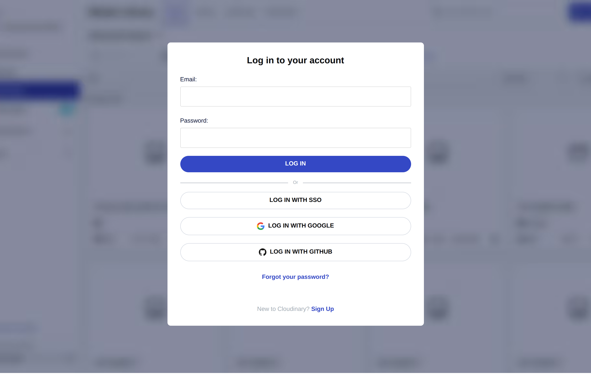
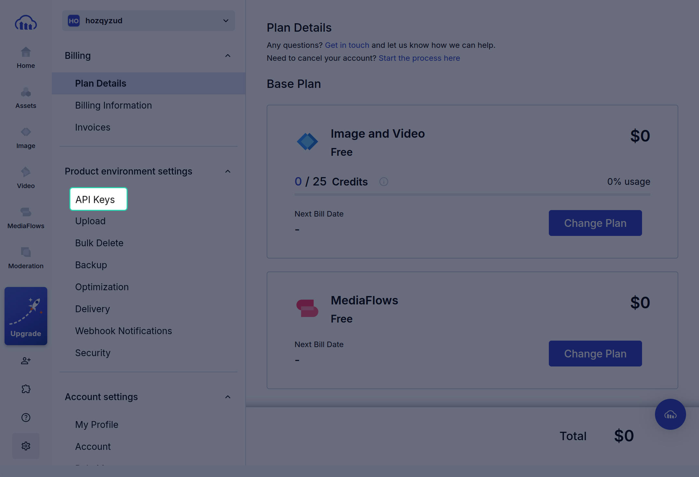
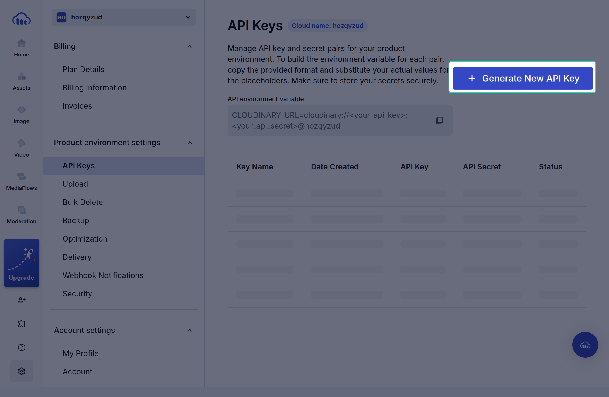
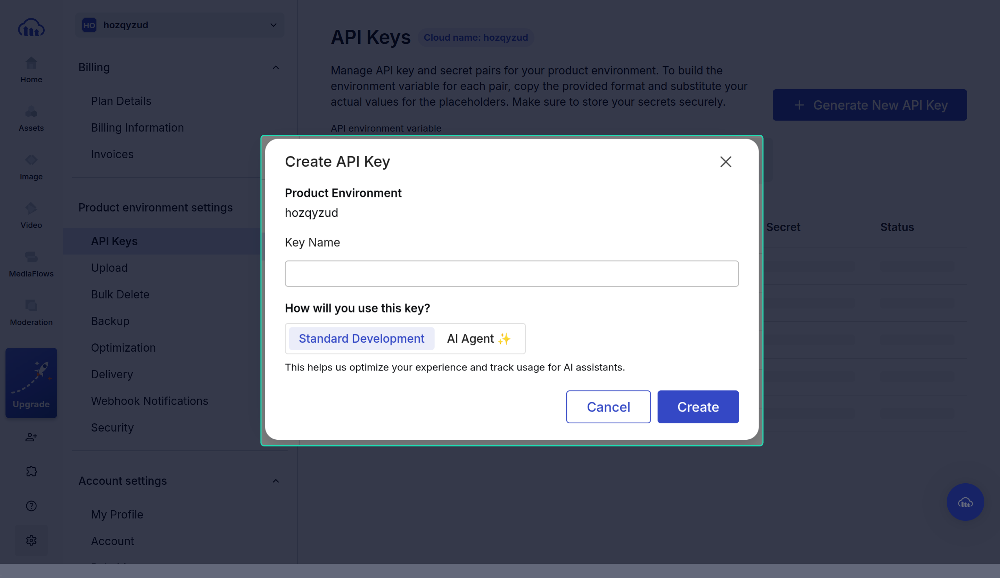

# Cloudinary Account Setup & API Credentials

Before configuring the connector in UnoPim, you need three credentials from your Cloudinary console:

- **Cloud Name**
- **API Key**
- **API Secret**

These credentials authorize UnoPim to upload product assets directly to your Cloudinary storage environment and serve media via Cloudinary CDN.

Follow the steps below to find and generate them.

---

## Step 1: Log in to Cloudinary

Go to [cloudinary.com/users/login](https://cloudinary.com/users/login) and log in with your account credentials. If you do not have an account yet, click **Sign Up** to create a free account.

Once logged in, you will be directed to your Cloudinary Console dashboard.

---

## Step 2: Open Product Environment Settings

1. From the left sidebar navigation, click the **Settings (gear icon)** at the bottom-left corner.
2. In the settings menu, locate the **Product environment settings** section.
3. Click on **API Keys**.

---

## Step 3: Note Your Cloud Name & Generate a New Key

On the **API Keys** management screen:

1. Look at the top next to the **API Keys** header. You will find your **Cloud name** badge (for example, `Cloud name: your_cloud_name`). Note down this name; you will need it in UnoPim.
2. Click the **+ Generate New API Key** button located in the top-right corner.

---

## Step 4: Create API Key & Copy Credentials

A **Create API Key** modal will appear:

1. **Key Name:** Enter a recognizable name (for example, `UnoPim Connector`).
2. **How will you use this key?:** Select **Standard Development**.
3. Click the **Create** button.

Once created, your new API Key and API Secret pair will be listed in the table:

| Credential | Description |
|---|---|
| **Cloud Name** | Your account's unique cloud identifier (visible at the top of the API Keys page). |
| **API Key** | The public identifier for your API access. |
| **API Secret** | The private secret token. Click the copy icon to copy it. |

::: warning Keep Your API Secret Confidential
Do not share your API Secret in public repositories, client-side scripts, or insecure channels. UnoPim securely encrypts these credentials in the database upon saving.
:::

---

## Next Steps

Now that you have your **Cloud Name**, **API Key**, and **API Secret**, proceed to [Installation](./installation.md) to install the connector package in UnoPim.
