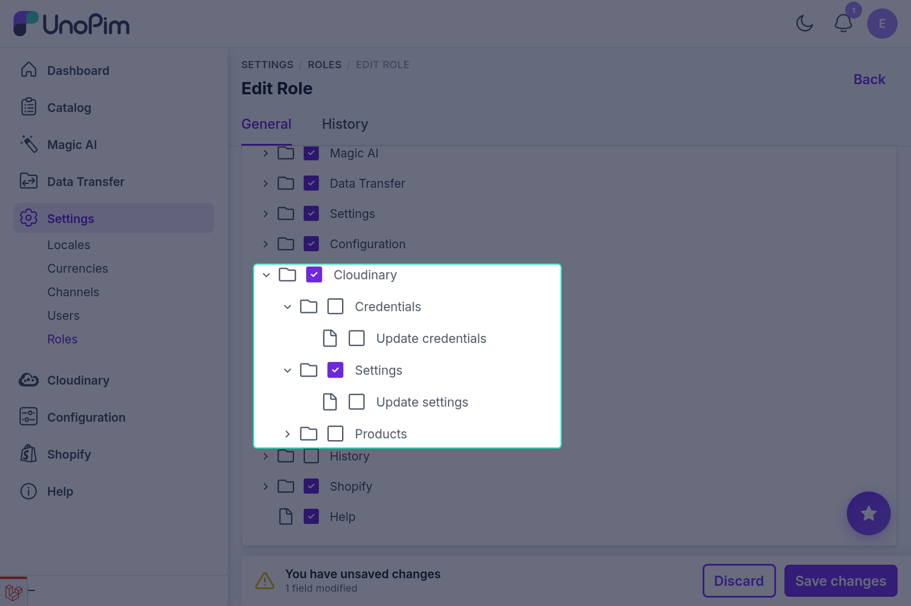
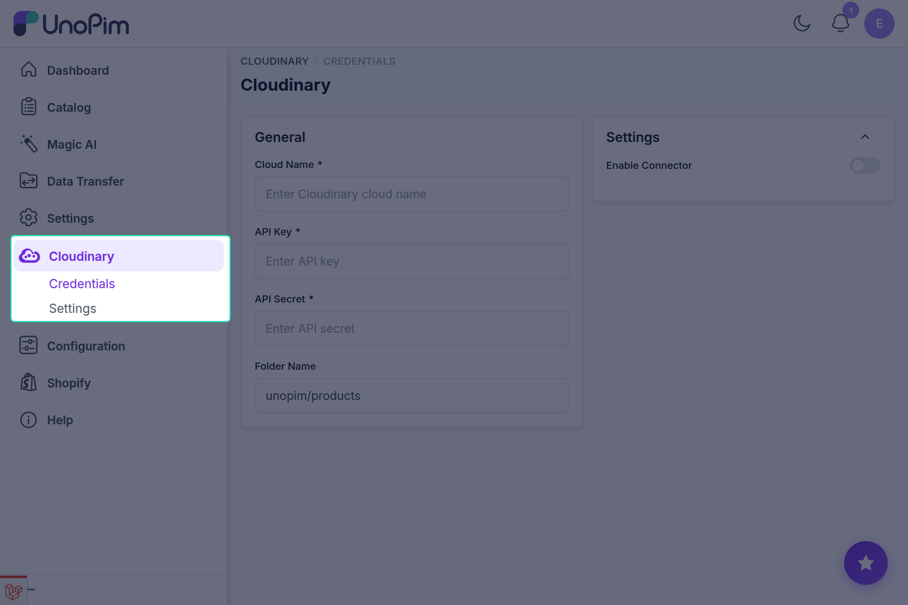

# Installation

This guide walks through installing and registering the **Cloudinary Connector** in your UnoPim instance.

---

## Installation Steps

### Step 1: Place the Package Files

Extract or place the connector package into the following directory inside your UnoPim project root:

```
packages/Webkul/Cloudinary/
```

---

### Step 2: Register Autoloading in composer.json

Open the root `composer.json` file in your UnoPim project and add the namespace under `autoload.psr-4`:

```json
"autoload": {
    "psr-4": {
        "Webkul\\Cloudinary\\": "packages/Webkul/Cloudinary/src"
    }
}
```

---

### Step 3: Register the Service Provider

Open `bootstrap/providers.php` and add `CloudinaryServiceProvider`:

```php
use Webkul\Cloudinary\Providers\CloudinaryServiceProvider;

return [
    // Other service providers...
    CloudinaryServiceProvider::class,
];
```

---

### Step 4: Run Autoloader and Migrations

Execute the following commands in your UnoPim root directory:

```bash
composer dump-autoload
php artisan migrate
```

| Command | Purpose |
|---|---|
| `composer dump-autoload` | Regenerates Composer's class map to recognize the new Cloudinary namespace. |
| `php artisan migrate` | Creates the `cloudinary_configurations` and `cloudinary_media` database tables. |

---

### Step 5: Start the Queue Worker

Because image uploads and bulk synchronization are handled asynchronously in the background, ensure your Laravel queue worker is active:

```bash
php artisan queue:work
```

::: tip Production Recommendation
In production environments, run queue workers using a process supervisor such as **Supervisor** or **systemd** to ensure the queue worker restarts automatically if it stops.
:::

---

### Step 6: Configure Role Permissions

To allow admin users to access and manage the connector:

1. Log in to your UnoPim admin panel.
2. Navigate to **Settings → Roles**.
3. Edit the desired user role (e.g., Administrator).
4. Under the **Permissions** tree, ensure the **Cloudinary** permissions are checked:
   - **Cloudinary** - Base permission to view the Cloudinary navigation section.
   - **Credentials** - View and update Cloudinary API credentials.
   - **Settings** - View and update image transformation and optimization settings.
   - **Products** - Sync product media with Cloudinary.
5. Click **Save Role**.

<!-- ============================================================ -->
<!-- SCREENSHOT PLACEHOLDER: Role Permissions                     -->
<!-- IMAGE_NAME: role-permissions.png                             -->
<!-- Location: docs/cloudinary/images/role-permissions.png        -->
<!-- Description: UnoPim Settings -> Roles -> Permissions tree with Cloudinary, Credentials, Settings, and Products checked -->
<!-- ============================================================ -->


---

## Verifying the Installation

After completing the steps above:

1. Refresh your UnoPim admin dashboard.
2. A new **Cloudinary** item will appear in the main left navigation sidebar.
3. Click on **Cloudinary** to access the configuration screen.

<!-- Screenshot Placeholder: Cloudinary Sidebar Icon -->
<!-- TODO: Add screenshot of UnoPim left navigation bar highlighting the Cloudinary menu item -->


Proceed to [Setup Credentials & Settings](./setup.md) to link your Cloudinary account.
