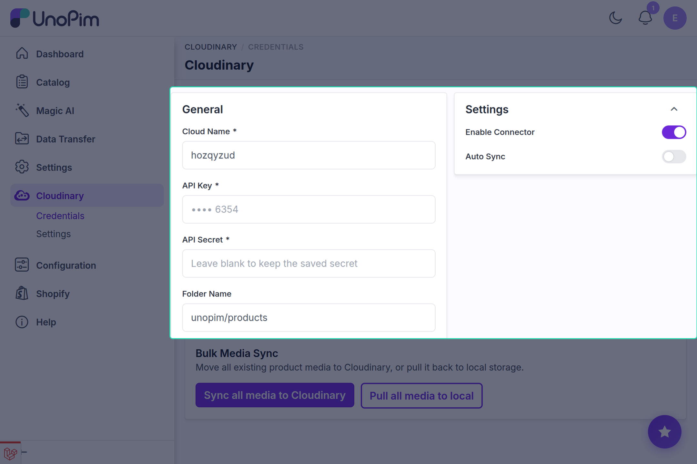

# Setting Up Credentials & Connector Settings

After installing the connector, the next step is connecting your Cloudinary account to UnoPim and configuring media synchronization preferences.

---

## Accessing the Configuration Page

1. Log in to your UnoPim admin panel.
2. In the left-hand navigation sidebar, click on **Cloudinary → Credentials**.

<!-- ============================================================ -->
<!-- SCREENSHOT PLACEHOLDER: Cloudinary Sidebar Navigation        -->
<!-- IMAGE_NAME: cloudinary-sidebar-menu.png                      -->
<!-- Location: docs/cloudinary/images/cloudinary-sidebar-menu.png -->
<!-- Description: UnoPim left navigation bar showing Cloudinary expanded with Credentials and Settings submenus -->
<!-- ============================================================ -->

You will be directed to the **Cloudinary Connector Configuration** page.

---

## Configuring Connection Parameters

Fill in the configuration fields using the credentials obtained from your Cloudinary Console (refer to [Cloudinary Setup](./cloudinary-setup.md)):

<!-- ============================================================ -->
<!-- SCREENSHOT PLACEHOLDER: Cloudinary Credentials Form          -->
<!-- IMAGE_NAME: cloudinary-configuration-form.png                -->
<!-- Location: docs/cloudinary/images/cloudinary-configuration-form.png -->
<!-- Description: Full page view of the Cloudinary Credentials configuration form (/admin/cloudinary/credentials) -->
<!-- ============================================================ -->

### Field Reference

| Field | Requirement | Description |
|---|---|---|
| **Enable Connector** | Required | Toggle **Yes** to activate Cloudinary integration, or **No** to keep it inactive. |
| **Auto Sync Product Images** | Required (if Enabled) | When set to **Yes**, product media is automatically uploaded to Cloudinary whenever a product is created or updated in UnoPim. |
| **Cloud Name** | Required (if Enabled) | Your unique Cloudinary cloud identifier (e.g., `unopim-cloud`). |
| **API Key** | Required (if Enabled) | The API Key generated from your Cloudinary console. |
| **API Secret** | Required (if Enabled) | The API Secret generated alongside your API Key. Once saved, UnoPim encrypts and masks this field for security. |
| **Folder Name** | Optional | Target directory path in Cloudinary where media will be organized. Defaults to `unopim/products`. |

---

## Saving and Verifying Credentials

1. Once all details are filled in, click **Save Configuration** at the top right of the page.
2. UnoPim automatically performs a credential verification call to the Cloudinary API.
3. Upon successful validation, a confirmation message appears:
   > *Cloudinary configuration saved successfully.*

::: tip Credential Validation Error
If you receive the error *"The Cloudinary credentials are invalid. Please check the cloud name, API key, and API secret"*, verify that there are no accidental spaces before or after your copied keys.
:::

---

## Disabling the Connector

If you ever need to disable the connector:

::: warning Important: Pull Media First
Before setting **Enable Connector** to **No**, always use the **Pull all media to local** button in the Bulk Media Sync section. This ensures all product images stored on Cloudinary are downloaded back to your local UnoPim storage, preventing broken image links.
:::

---

## Next Step: Image Transformations

Once your credentials are authenticated, configure dynamic image resizing, automated WebP/AVIF formatting, and AI object focus in [Image Transformations & Optimization](./transformations.md).
