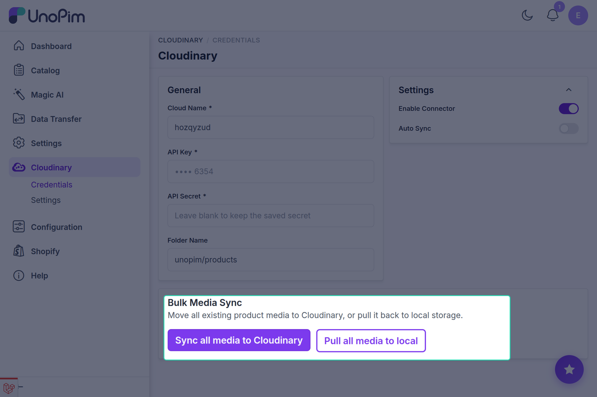

# Media Synchronization

The **Cloudinary Connector** provides multiple options for syncing catalog media between UnoPim and your Cloudinary environment.

---

## 1. Automatic Real-Time Synchronization

When **Auto Sync Product Images** is set to **Yes** in the connector configuration:

- Whenever an administrator or import job adds or updates product images in UnoPim, the connector automatically dispatches an upload job to the queue.
- Media files are transferred to Cloudinary under the configured folder, and the corresponding Cloudinary public ID and secure URL are mapped.
- Original media associations and catalog indexing remain intact.

---

## 2. Bulk Media Sync via Admin UI

If you already have existing products with local images prior to installing the connector, or if you need to migrate media between local storage and Cloudinary in batch, use the **Bulk Media Sync** section located at the bottom of the Cloudinary configuration page (**Cloudinary → Credentials**).

<!-- ============================================================ -->
<!-- SCREENSHOT PLACEHOLDER: Bulk Media Sync Section              -->
<!-- IMAGE_NAME: bulk-media-sync.png                              -->
<!-- Location: docs/cloudinary/images/bulk-media-sync.png         -->
<!-- Description: Bulk Media Sync card showing Sync all media and Pull all media buttons -->
<!-- ============================================================ -->


### Sync all media to Cloudinary

1. Click **Sync all media to Cloudinary**.
2. UnoPim dispatches a background task scanning all product image attributes and DAM asset associations.
3. Media files stored locally are uploaded to Cloudinary, and media records are updated.
4. A notification indicates that media synchronization has started in the background.

---

### Pull all media to local

Use this option to retrieve all images currently stored on Cloudinary and save them back to UnoPim's local filesystem (`storage/app/public`):

1. Click **Pull all media to local**.
2. UnoPim fetches the original assets from Cloudinary and writes them to local storage.
3. Once completed, your catalog images are safely restored locally.

::: tip Recommended Before Disabling
Always run **Pull all media to local** prior to disabling the Cloudinary connector so that your product catalog continues serving images without interruption.
:::

---

## 3. CLI Console Commands

For large catalogs with thousands of high-resolution images, running synchronization via the command line interface (CLI) is recommended.

### Push Local Media to Cloudinary

To synchronize all product media from local storage to Cloudinary:

```bash
php artisan cloudinary:sync-media
```

**Console Output:**
```text
Pushing local media to Cloudinary...
  synced product #101
  synced product #102
  ...
Done. Products processed: 250, files synced: 480.
```

---

### Pull Cloudinary Media to Local Storage

To pull all Cloudinary media back to local storage:

```bash
php artisan cloudinary:sync-media --pull
```

**Console Output:**
```text
Pulling Cloudinary media back to local storage...
  pulled product #101
  pulled product #102
  ...
Done. Products processed: 250, files pulled: 480.
```

---

## Queue Monitoring

Ensure your queue worker is running while bulk actions are dispatched:

```bash
php artisan queue:work --tries=3 --timeout=120
```

You can view the progress and logs under `storage/logs/laravel.log`.
