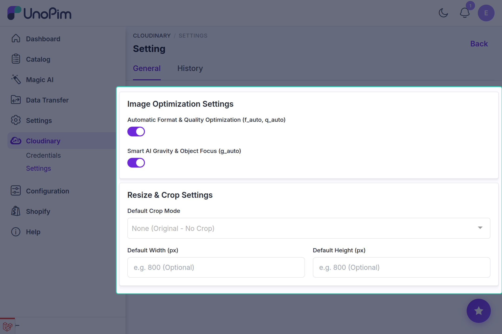
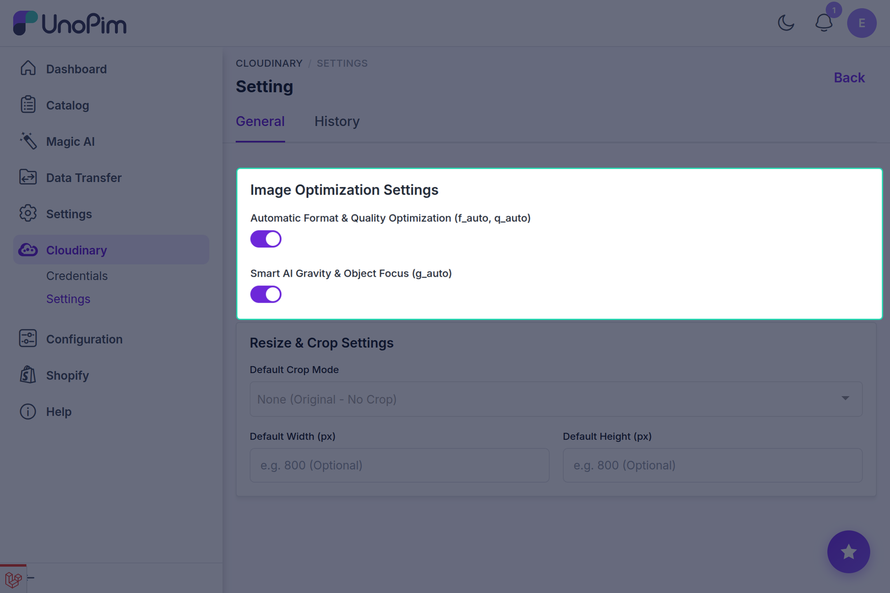
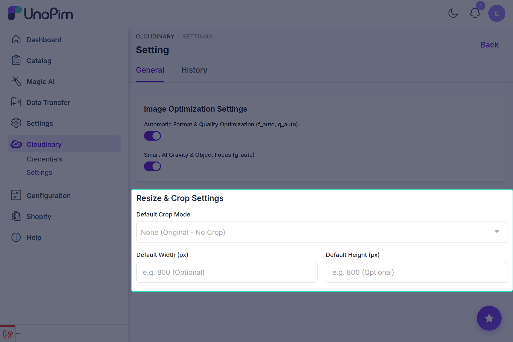
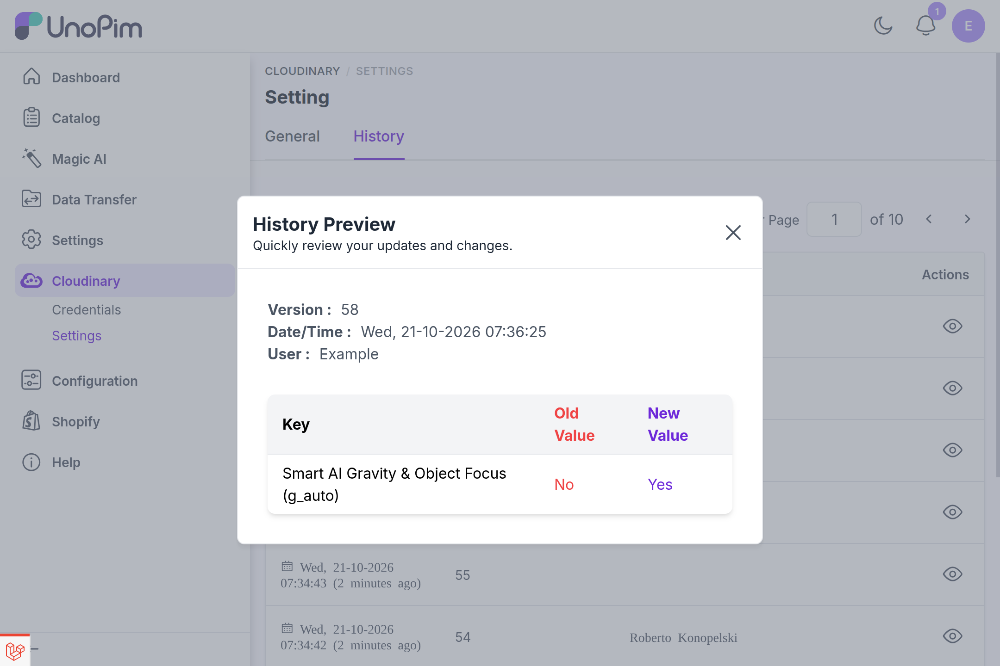

# Dynamic Image Transformations & Transfer Settings

The **UnoPim Cloudinary Connector** includes a powerful dynamic image transformation and transfer pipeline. Rather than generating multiple static image variations on your server disk, the connector leverages Cloudinary's dynamic CDN transformations to optimize, crop, resize, and transfer product images on the fly.

This architecture ensures your original catalog assets remain safely stored in their native high resolution while your storefronts, export channels, and UnoPim admin screens receive blazing-fast, responsive, and perfectly optimized media.

---

## Accessing Transformation Settings

1. Log in to your UnoPim admin panel.
2. In the left navigation sidebar, navigate to **Cloudinary → Settings**.

<!-- ============================================================ -->
<!-- SCREENSHOT PLACEHOLDER: Cloudinary Settings Page Overview    -->
<!-- IMAGE_NAME: cloudinary-transformation-settings.png           -->
<!-- Location: docs/cloudinary/images/cloudinary-transformation-settings.png -->
<!-- Description: Full page view of the Cloudinary Settings screen showing the Image Optimization and Resize & Crop cards -->
<!-- ============================================================ -->

From this screen, you can configure format and quality optimization, content-aware AI focus, default crop algorithms, and target dimensions.

---

## 1. Automated Dynamic Image Optimization

Serving unoptimized or inappropriately formatted images degrades catalog performance, slows down storefronts, and increases bounce rates. The connector provides two automated, zero-maintenance optimization toggles:

<!-- ============================================================ -->
<!-- SCREENSHOT PLACEHOLDER: Image Optimization Settings Card     -->
<!-- IMAGE_NAME: cloudinary-optimization-settings.png             -->
<!-- Location: docs/cloudinary/images/cloudinary-optimization-settings.png -->
<!-- Description: Focused view of the Image Optimization Settings card showing f_auto, q_auto, and g_auto switches -->
<!-- ============================================================ -->

### Automatic Format & Quality Optimization (`f_auto, q_auto`)

- **Dynamic Format Delivery (`f_auto`)**:
  - Cloudinary inspects the incoming request's `Accept` HTTP header and the visitor's browser or device capabilities.
  - Automatically delivers next-generation image formats such as **AVIF** or **WebP** when supported by the client.
  - Automatically falls back to high-grade **JPEG** or **PNG** for older browsers or legacy client applications without requiring separate file uploads.
- **Intelligent Perceptual Compression (`q_auto`)**:
  - Employs advanced psychovisual algorithms to analyze each image's unique visual content, texture complexity, and edge details.
  - Adjusts compression levels dynamically to achieve maximum byte savings while maintaining visually lossless fidelity.
  - Eliminates human guesswork in balancing quality settings versus file weight.

::: tip Proven Bandwidth Reduction
Enabling **Automatic Format & Quality Optimization** typically reduces image payload by **40% to 70%** across product catalog galleries, drastically speeding up catalog page loads and improving SEO Core Web Vitals (LCP/CLS).
:::

---

### Smart AI Gravity & Object Focus (`g_auto`)

When images of varying aspect ratios are cropped to fit uniform catalog cards or square thumbnails, standard center-point cropping can inadvertently cut off shoes, jewelry, model faces, or apparel edges.

- **Content-Aware AI Detection**: Cloudinary's AI gravity engine analyzes image composition to identify the primary subject, bounding silhouette, and focal highlights.
- **Dynamic Viewport Centering**: When cropping or scaling, the viewport automatically centers on the detected subject, ensuring critical product features are never clipped.
- **URL Parameter**: Injects `g_auto` into generated Cloudinary URLs.

---

## 2. Dynamic Resize & Cropping Architecture

Standardize catalog image presentation across your catalog channels without manually re-uploading resized variations.

<!-- ============================================================ -->
<!-- SCREENSHOT PLACEHOLDER: Resize & Crop Settings Card          -->
<!-- IMAGE_NAME: cloudinary-crop-settings.png                     -->
<!-- Location: docs/cloudinary/images/cloudinary-crop-settings.png -->
<!-- Description: Focused view of the Resize & Crop Settings card showing the Crop Mode dropdown and Width/Height inputs -->
<!-- ============================================================ -->

### Crop Mode Options

Select the desired cropping algorithm from the **Default Crop Mode** dropdown:

| Crop Mode | Code | Technical Behavior | Best For |
|---|---|---|---|
| **None (Original)** | `none` | Retains the original dimensions and aspect ratio without injecting any crop flags. | High-resolution zoom views and archival inspection. |
| **Fill & Crop** | `c_fill` | Resizes the image to completely fill the specified width and height. Crops excess outer edges without stretching or aspect distortion. | Uniform product grids, square catalog tiles, and category thumbnails. |
| **Fit Within** | `c_fit` | Proportionally scales down the image so that its largest dimension fits within the bounding box. Zero cropping occurs; all original pixels remain visible. | Responsive product detail cards, mobile previews, and diverse product categories. |
| **Fit & Add Padding** | `c_pad` | Resizes the image to fit within the bounding box and pads the remaining background borders with white or transparent padding. | Maintaining identical canvas sizes across mixed portrait, square, and landscape catalog photos. |
| **Scale Width / Height** | `c_scale` | Resizes width and height directly while preserving the original aspect ratio. | Basic proportional dimension scaling. |

---

### Default Dimensions (Width & Height)

- **Default Width (px)**: Enter target width in pixels (e.g., `800`). Optional.
- **Default Height (px)**: Enter target height in pixels (e.g., `800`). Optional.

::: info Intelligent Fallback Protection
If you specify a **Default Width** or **Default Height** but leave **Default Crop Mode** set to `None`, the connector automatically applies **`c_fit`**. This safety mechanism prevents images from being inadvertently distorted or stretched by missing crop parameters.
:::

---

## 3. Dynamic Image Transfer & Swapping Pipeline

The Cloudinary Connector integrates deeply into UnoPim's core media subsystem to dynamically swap local file paths with secure Cloudinary CDN delivery URLs.

### Dynamic Catalog Display (`ProductImage`)

- The connector extends UnoPim's native `ProductImage` service.
- Whenever product base images (`getProductBaseImage()`) or gallery images (`getGalleryImages()`) are requested, UnoPim automatically resolves:
  - `small_image_url`
  - `medium_image_url`
  - `large_image_url`
  - `original_image_url`
- Each variant dynamically receives the Cloudinary CDN URL equipped with your active transformation string (`f_auto,q_auto,g_auto,c_fill,w_800,h_800`).

---

### Cache Busting with Asset Versioning (`_cb=v...`)

When a product image is updated or re-uploaded with the same filename:
- The connector retrieves the asset version assigned by Cloudinary.
- Appends a cache-busting query parameter (e.g., `?_cb=v1712345678`) to the delivery URL.
- This ensures web browsers and CDN edge caches immediately display the newly uploaded asset without waiting for HTTP cache expiration.

---

### Dynamic Transfer During Product Export & Quick Export

When exporting catalog data from UnoPim to downstream ecommerce channels:

- **Full Catalog Exports**: The connector's `ProductExporter` intercepts media columns (`image`, `gallery`, `file`, and DAM `asset` types) during standard export jobs.
- **Quick Export from DataGrid**: When performing quick exports directly from the Product DataGrid, `ProductDataGrid` automatically replaces local file paths with active Cloudinary URLs.
- **Omnichannel Compatibility**: Channels such as Shopify, Magento 2, WooCommerce, and BigCommerce receive direct, publicly accessible CDN links without requiring manual file uploads.

---

## 4. Transformation Audit Trail & Version History

UnoPim tracks all changes made to your Cloudinary transformation settings so teams can review who made adjustments and when.

<!-- ============================================================ -->
<!-- SCREENSHOT PLACEHOLDER: Settings History & Audit Trail       -->
<!-- IMAGE_NAME: cloudinary-history-diff.png                      -->
<!-- Location: docs/cloudinary/images/cloudinary-history-diff.png -->
<!-- Description: History audit screen showing diff of old vs new values for crop mode, width, height, and optimization flags -->
<!-- ============================================================ -->

1. On the **Cloudinary → Settings** page, click the **History** button at the top right.
2. The audit trail displays chronological records of modifications to:
   - Automatic format & quality optimization toggle
   - Smart AI gravity toggle
   - Default crop mode
   - Default width & height

---

## 5. Delivery URL Reference Examples

The table below illustrates how the connector constructs dynamic Cloudinary URLs based on active settings:

| Active Settings | Generated Delivery URL Pattern |
|---|---|
| **Default Optimization Only** | `https://res.cloudinary.com/<cloud>/image/upload/f_auto,q_auto,g_auto/v1/unopim/products/item.jpg?_cb=v1` |
| **Optimization + Square Crop (800x800)** | `https://res.cloudinary.com/<cloud>/image/upload/f_auto,q_auto,g_auto,c_fill,w_800,h_800/v1/unopim/products/item.jpg?_cb=v1` |
| **Proportional Bounding Box (1200x900)** | `https://res.cloudinary.com/<cloud>/image/upload/f_auto,q_auto,c_fit,w_1200,h_900/v1/unopim/products/item.jpg?_cb=v1` |
| **Padded Canvas with Transparent Border** | `https://res.cloudinary.com/<cloud>/image/upload/f_auto,q_auto,c_pad,w_1000,h_1000/v1/unopim/products/item.jpg?_cb=v1` |

---

## Next Steps

- Proceed to [Media Synchronization](./sync-media.md) to migrate your product catalog media.
