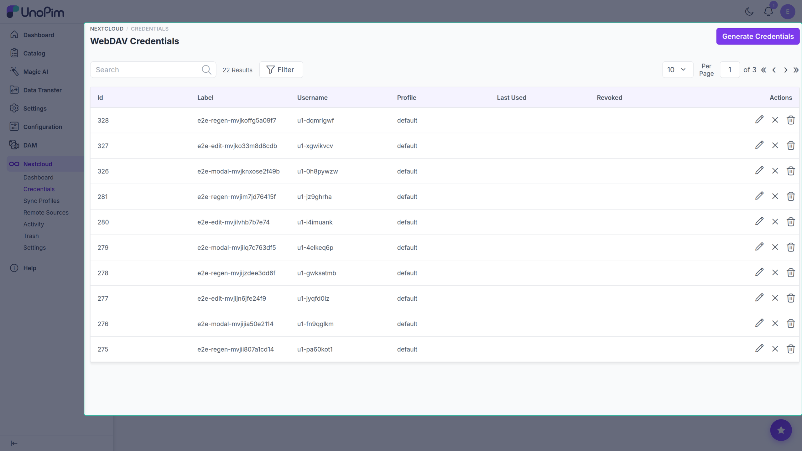
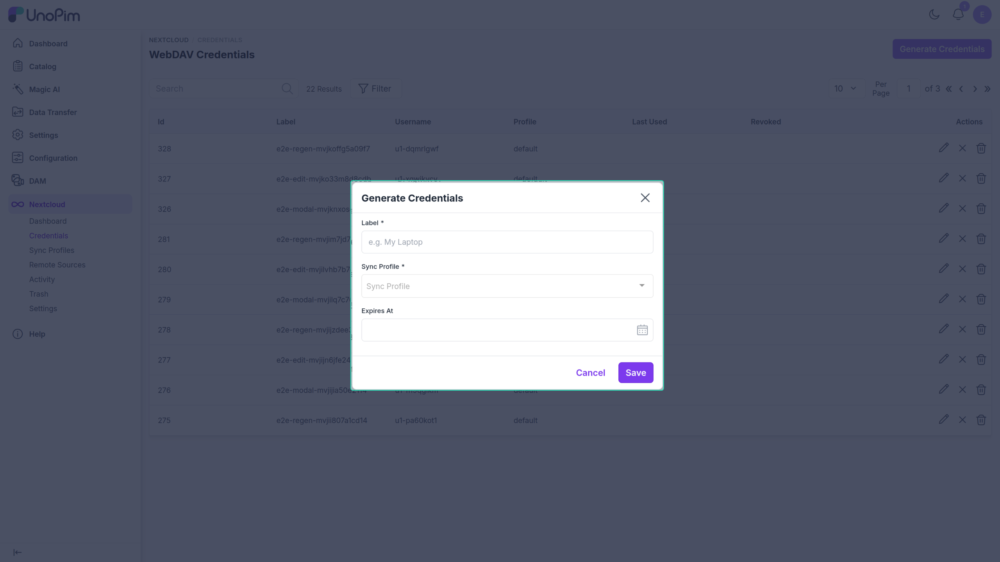
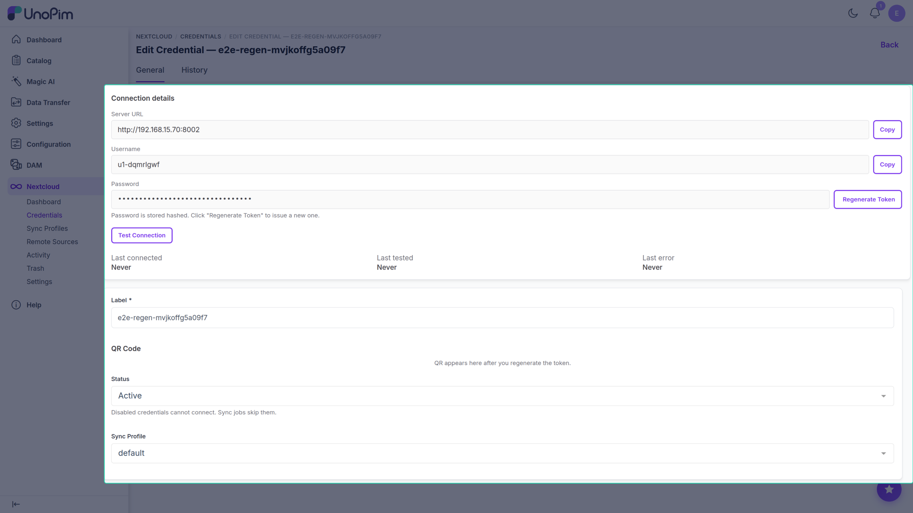

# Credentials

A **Credential** is a WebDAV user account that desktop and mobile clients use to authenticate against UnoPim. UnoPim auto-generates the username and app-password — you supply only a label, a Sync Profile, and an optional expiry date.

Each credential belongs to the admin user who created it. Non-super-admin users can only see and manage credentials they created themselves.

## List

Columns:

- **Label** — human-readable name (e.g., "Studio iMac").
- **Username** — the WebDAV username auto-assigned by UnoPim.
- **Profile** — the Sync Profile this credential is bound to.
- **Last Used** — last successful authentication timestamp.
- **Status** — Active / Disabled.
- **Actions** — Edit, Delete.

> [!NOTE]
> A credential cannot be created until at least one [Sync Profile](./sync-profiles) exists. If no profiles are configured, the list page shows a prompt to create one first.

## Generate

Click **Generate** to open the creation modal. Fields:

- **Label** — display name. Required.
- **Profile** — the Sync Profile this credential will use. Required.
- **Expires At** — optional expiry date/time. Leave blank for a non-expiring credential.

On save, UnoPim generates a unique username and a 32-character app-password, then redirects to the **Edit** page where both are shown **once**.

## Edit page — connection info

The edit page has two sections: the **Connection Info** panel on the left and the **settings** panel on the right.

### Connection Info panel

- **Server URL** — the UnoPim base URL; copy it and paste into the Nextcloud client.
- **Username** — the auto-assigned WebDAV username; copy-to-clipboard button included.
- **Password** — the app-password. Shown in plain text **only immediately after generation or regeneration** (green highlight). On subsequent visits the field shows `••••••••••••••••••••••••••••••••` with a hint to regenerate if the token is lost.

Below the password row:

- **Test Connection** button — prompts for the current app-password, validates it via the same hash-check the WebDAV middleware uses, and reports latency in milliseconds. The result (`ok` / `failed` + latency) is saved as the credential's last-test timestamp.
- **Regenerate** button — generates a new 32-character token, immediately invalidates the old one, and redirects back to the edit page so the new token is shown once. A confirmation prompt is shown before the token is replaced.

Below the connection fields, a **Health** row shows:

| Field | Description |
|---|---|
| Last Used At | When this credential last authenticated successfully |
| Last Tested At | When Test Connection was last used and whether it passed |
| Last Error At | When WebDAV last returned an error for this credential and the error message |

### Settings panel

- **Label** — editable display name.
- **QR code** — shown immediately after generation/regeneration. Encodes the `nc://login/...` deep-link so a Nextcloud iOS/Android user can scan it instead of typing the server URL manually. A **Download** button saves the QR as an SVG. On subsequent visits a note is shown instead: *"Regenerate the token to display a new QR code."*
- **Status** — Active / Disabled. Setting to Disabled immediately revokes access; the client will receive `401` on its next sync tick.
- **Profile** — change the Sync Profile this credential is bound to.
- **Expires At** — only shown when the credential has an expiry date set; edit or clear it here.

## How to use

1. Create a [Sync Profile](./sync-profiles) first — credentials cannot be created without one.
2. On the Credentials list, click **Generate**.
3. Enter a Label, pick a Profile, optionally set an expiry, and click **Save**.
4. On the Edit page, copy the **Server URL** and **Username** and note the **Password** (shown once).
5. Send the Server URL to the Nextcloud user, or let them scan the **QR code** from a mobile device.
6. To verify setup, click **Test Connection**, enter the app-password when prompted, and confirm the result is `ok`.

## Tips

- One credential per device, not per user. If the same person uses Nextcloud Desktop and Nextcloud mobile, give each device its own credential so revocation is granular.
- If a credential's password is lost (navigated away before copying), use **Regenerate** to issue a new token — the old one is permanently replaced.
- Disabling a credential immediately invalidates active locks; the client will see `401` on the next sync tick and stop syncing.
- Non-super-admin users see only credentials they own. Full admins see all credentials.
- Setting an **Expires At** date auto-revokes the credential at that time without any manual action.
