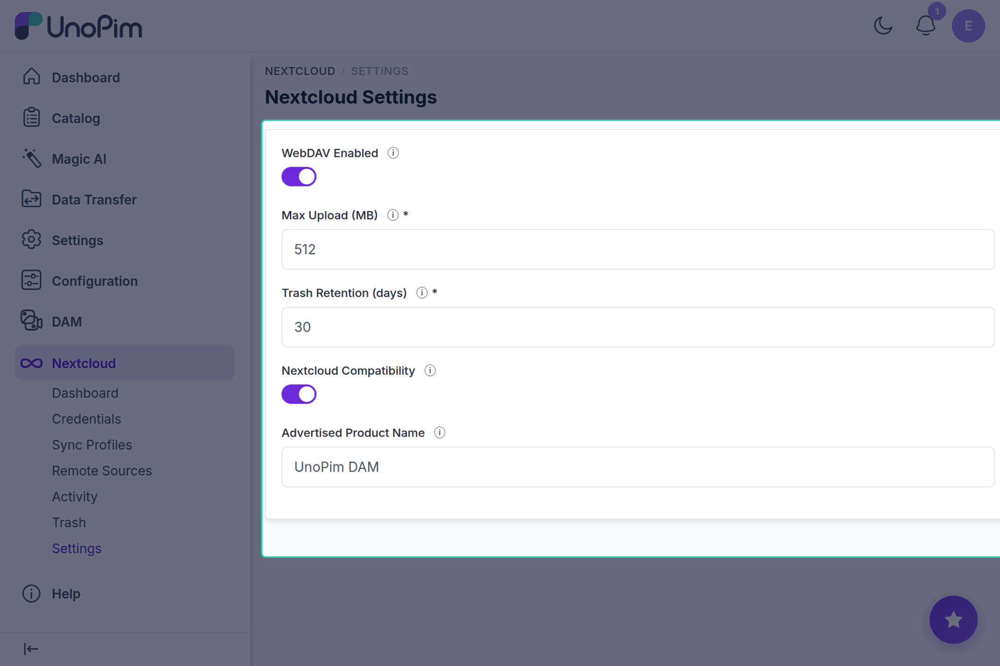

# Settings

Module-level settings that apply across all credentials, profiles, and remote sources. Changes take effect immediately without restarting the queue or the web server.

## Fields



| Field | Default | Description |
|---|---|---|
| **WebDAV Enabled** | On | Master switch. Turning this off returns `503` on all WebDAV endpoints and blocks the Nextcloud login-flow. Useful for emergency maintenance without uninstalling the module. |
| **Max Upload MB** | 512 | Global maximum file size accepted via any WebDAV PUT. Individual [Sync Profiles](./sync-profiles) can set a lower per-profile limit; this value is the upper bound. |
| **Trash Retention (days)** | 30 | How long soft-deleted assets are kept in [Trash](./trash) before the nightly purge job removes them permanently. |
| **Nextcloud Compatibility** | On | Enables the Nextcloud-compatible response headers and `/status.php` / OCS endpoints that the official Nextcloud Desktop and mobile apps require. Disable only if you are using plain WebDAV clients (davfs2, Cyberduck, Finder) exclusively and want a leaner response surface. |
| **NC Product Name** | UnoPim DAM | The product name advertised to Nextcloud clients in `/status.php`. Changing this affects what the Nextcloud desktop client displays in its account list. |

## How to use

1. Open **Nextcloud → Settings**.
2. Adjust the values; the form validates ranges (Max Upload ≥ 1 MB, Trash Retention ≥ 1 day).
3. Click **Save**. Settings are stored in the Laravel cache and take effect on the next request.

## Environment variable overrides

The same settings can be seeded via `.env` before the first request. Admin-panel values take precedence over `.env` once saved.

```ini
DAM_WEBDAV_ENABLED=true
DAM_WEBDAV_MAX_UPLOAD_MB=512
DAM_WEBDAV_TRASH_RETENTION_DAYS=30
DAM_WEBDAV_NC_COMPAT=true
DAM_WEBDAV_NC_PRODUCT="UnoPim DAM"
```

Additional low-level variables (not exposed in the UI) that can only be set via `.env`:

```ini
# URL prefix for the WebDAV endpoint (requires nginx reload when changed)
DAM_WEBDAV_BASE_PATH=/webdav/dam

# HTTP Basic Auth realm shown in client dialogs
DAM_WEBDAV_REALM="UnoPim DAM"

# How often the remote-source sync scheduler fires (minutes)
DAM_WEBDAV_SYNC_SCHEDULE_MINUTES=5

# Time of day for the nightly trash-purge job (HH:MM, server time)
DAM_WEBDAV_TRASH_PURGE_AT=02:00
```

## Tips

- If you change `DAM_WEBDAV_BASE_PATH` in `.env`, update the corresponding nginx location block and reload nginx — the WebDAV endpoint and the Nextcloud client both rely on that path.
- Increasing **Trash Retention** is a non-destructive change; assets already in Trash keep their original deletion timestamp and will be purged at `deletion_date + retention_days`.
- Turning **WebDAV Enabled** off does not revoke credentials or delete data — it simply gates all WebDAV traffic. Turning it back on restores access immediately.
