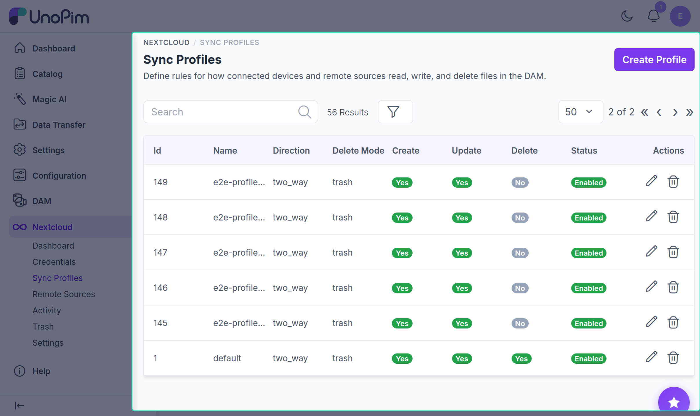
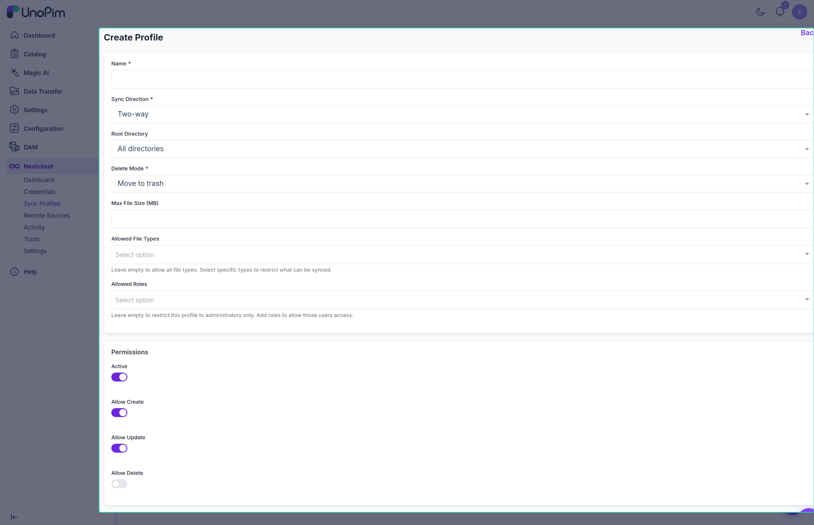

# Sync Profiles

A **Sync Profile** defines the rules applied to any credential bound to it: which DAM directory is exposed, which direction files flow, which operations are permitted, and which file types are accepted. Multiple credentials can share one profile; each credential can be bound to only one profile at a time.

## List

Columns:

- **Name**
- **Direction** — Two-way / Push only / Pull only.
- **Root Directory** — the DAM directory exposed as the WebDAV root, or "All directories" if unrestricted.
- **Status** — enabled / disabled toggle.
- **Last Sync** — timestamp of the most recent sync event against this profile.
- **Actions** — Edit, Delete.

> [!NOTE]
> The built-in **default** profile cannot be deleted. It is used as a fallback when a credential is created without specifying a profile.

## Create / Edit

### Main fields

| Field | Required | Description |
|---|---|---|
| **Name** | Yes | Unique display name for the profile (max 120 characters). |
| **Direction** | Yes | Controls which way files flow — see [Direction modes](#direction-modes) below. |
| **Root Directory** | No | Limits the client to a subtree of the DAM. Leave blank (or select "All directories") for unrestricted access to the entire DAM. |
| **Delete Mode** | Yes | How client-side deletions are handled: `hard` (permanent), `soft` (unlinked from directory but not purged), or `trash` (moved to Trash and retained for the configured period). |
| **Max File MB** | No | Per-file upload limit for this profile, in megabytes (1–102400). Overrides the global setting when set. |
| **Allowed File Types** | No | Multi-select restriction to allow only specific file categories (`Images`, `Documents`, `Videos`, `Audio`). Leave empty to allow all file types. |
| **Allowed Roles** | No | When set, only admin users whose role is in this list can use credentials bound to this profile. Leave blank to allow all admin roles. |

### Permission toggles

| Toggle | Default | Description |
|---|---|---|
| **Status** | On | Disable to block all access for credentials bound to this profile without deleting them. |
| **Allow Create** | On | Permit uploading new files via WebDAV. |
| **Allow Update** | On | Permit overwriting existing files via WebDAV. |
| **Allow Delete** | Off | Permit deleting files via WebDAV. When off, DELETE requests are rejected with `403`. |

### Direction modes

| Mode | Behavior |
|---|---|
| **Two-way** | Default. Changes from either side propagate — client uploads land in DAM; DAM changes are visible to the client on the next sync. |
| **Push only** | Client → DAM only. The client can upload and create files; it cannot delete or modify DAM-side files that it did not create. |
| **Pull only** | DAM → Client (read-only mount). The client can browse and download but cannot create, modify, or delete anything. |

## How to use

1. Click **Add Sync Profile**.
2. Enter a **Name** and pick a **Direction**.
3. Optionally select a **Root Directory** in the picker to limit the client to a subtree.
4. Set **Delete Mode** — use `trash` for any external-facing profile to recover accidental deletions.
5. Select **Allowed File Types** if you want to restrict uploads to specific formats (Images, Documents, Videos, Audio), or leave empty to allow all types.
6. Toggle **Allow Create / Update / Delete** as needed for the intended use case.
7. Save.
8. Go to [Credentials](./credentials) and generate a credential bound to this profile.

## Tips

- Create one profile per *type of access* (e.g., "Read-only external", "Agency drop-zone", "Partner two-way"), then issue multiple credentials against the same profile rather than one profile per user.
- Set **Allow Delete** off for any untrusted external user — combined with `delete_mode = trash`, accidental deletes from the DAM side can still be recovered, but the client cannot delete anything at all.
- Use **Allowed Roles** to restrict which UnoPim admin users can generate credentials for a profile. This prevents lower-privilege admins from creating credentials that exceed their own access level.
- Switching a noisy profile to **Pull only** during maintenance prevents clients from writing while cleanup is in progress.
