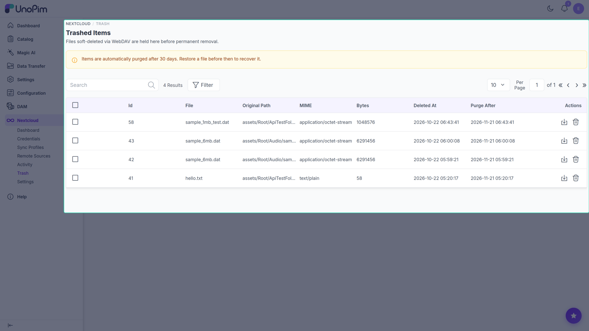

# Trash

When a client deletes a file inside a mounted folder and the credential's Sync Profile uses **Delete Mode = trash**, the DAM does **not** hard-delete. The asset moves to Trash and is retained for `trash_retention_days` (default 30) before automatic purge.



## Columns

- **Asset** — file name and thumbnail.
- **Original Path** — the directory the file was deleted from.
- **Deleted By** — the credential or remote source that triggered the deletion.
- **Deleted At** — timestamp of deletion.
- **Purges In** — days remaining before the nightly purge job permanently removes it.
- **Actions** — Restore, Delete forever.

## Restore

Clicking **Restore** moves the asset back to its original directory path. It reappears on every connected Nextcloud client on the next sync tick.

Edge cases the restore logic handles:

- **Path collision** — if a file with the same name already exists at the original path, the restored file is renamed `<name>-restored-N.<ext>` and the new path is logged.
- **Original directory removed** — the restore proceeds but the asset is unlinked from any directory; recover by attaching it to a directory in the DAM UI.
- **Blob missing on disk** — returns `422 Unprocessable` (`restore_failed`). The physical file was removed out-of-band; manual recovery is required.
- **Already restored** — the `restored_at` field is set; the entry is hidden from the active grid but retained for audit. Filter by `restored_at IS NOT NULL` in the database to inspect past restores.

## Delete forever

Clicking **Delete forever** (or **Purge**) permanently removes the asset from disk and the database immediately, regardless of the retention window.

## Bulk actions

The Trash grid supports mass actions for admins with the appropriate permissions:

- **Mass Restore** — restores all selected items; reports how many succeeded and how many failed.
- **Mass Purge** — permanently deletes all selected items.

Both bulk actions require the relevant ACL permissions (`nextcloud.trash.restore` and `nextcloud.trash.purge`) on the admin role.

## Automatic purge

The `nextcloud:trash:purge` job runs nightly at the time set by `DAM_WEBDAV_TRASH_PURGE_AT` (default `02:00` server time). It permanently removes all assets whose `deleted_at` is older than the configured retention period.

Run it immediately on demand:

```bash
php artisan nextcloud:trash:purge
```

## How to use

1. Open **Nextcloud → Trash**.
2. Find the asset (filter by date or by Deleted By).
3. Click **Restore** — the asset returns to its original directory and reappears in connected clients on the next sync tick.
4. Or click **Delete forever** to immediately purge.
5. Use the checkbox column and the **Mass Restore** / **Mass Purge** actions for bulk operations.

## Tips

- The **Delete Mode** on a Sync Profile controls whether client-side deletions go to Trash, are soft-deleted (unlinked), or are hard-deleted permanently. Only `trash` mode populates this page.
- Increase the retention window (`DAM_WEBDAV_TRASH_RETENTION_DAYS` or via [Settings](./settings)) for compliance use cases; decrease it to reduce storage pressure.
- Restoring during an active sync is safe — the lock is acquired per-asset.
