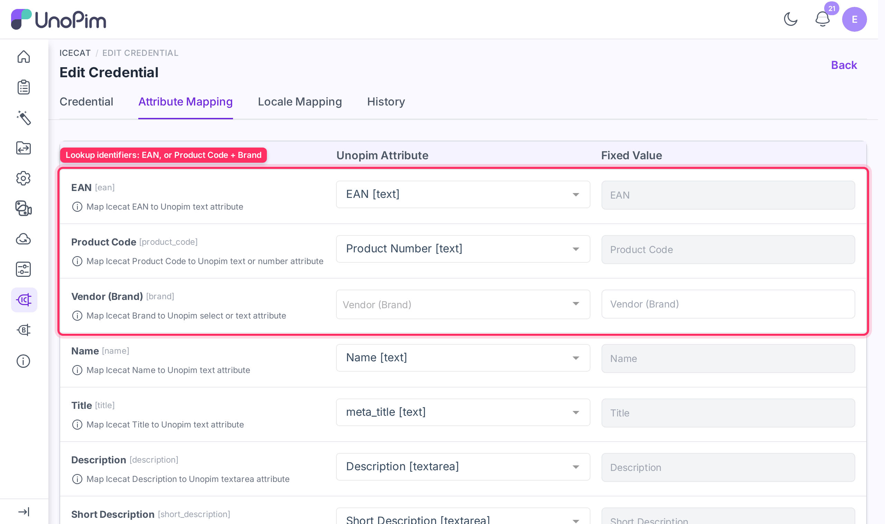
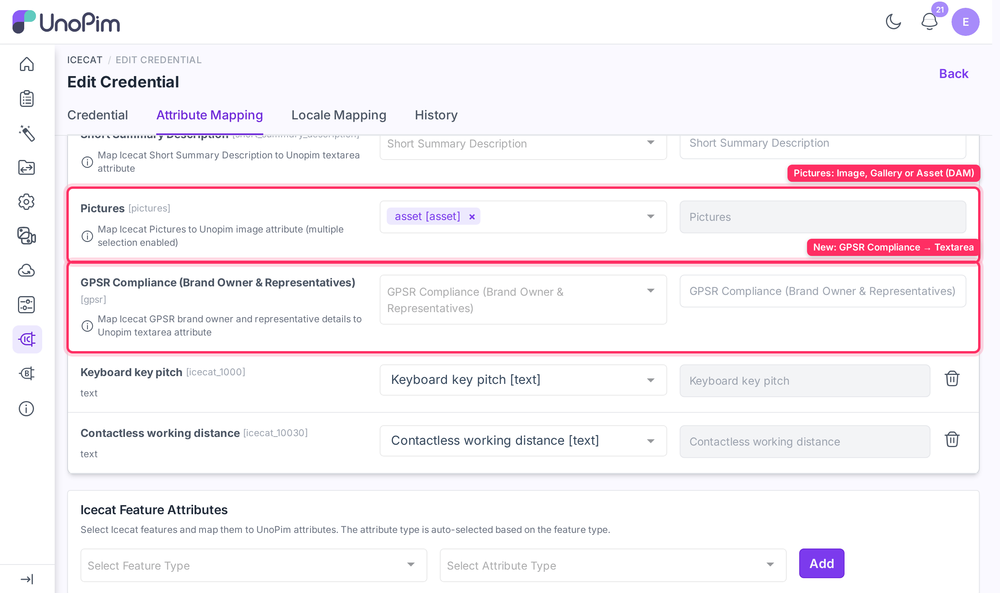
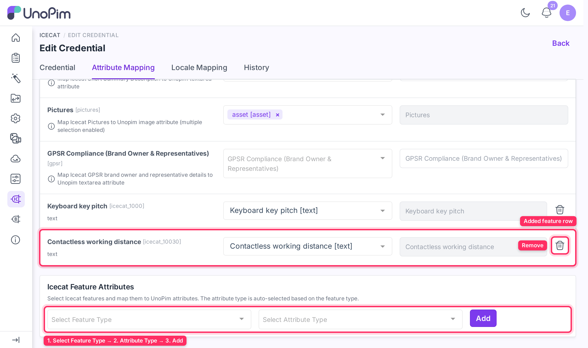

# Attribute Mapping

The **Attribute Mapping** tab on a credential controls which UnoPim attributes receive data from Icecat during enrichment. It is split into two sections: **Standard Attribute Mapping** and **Icecat Feature Attributes**.

Open it from **Icecat → Credentials → Edit → Attribute Mapping**.

## How the mapping screen works

Each row in the mapping table has three columns:

| Column | Purpose |
|---|---|
| **Icecat Field** | The Icecat field or feature being mapped (read-only). |
| **UnoPim Attribute** | The UnoPim attribute that receives the value from Icecat. Only attribute types compatible with the Icecat field are shown in the dropdown. |
| **Fixed Value** | An optional constant written to this field for every enriched product, regardless of what Icecat returns. |

For each row you can set either a **UnoPim Attribute** or a **Fixed Value** — not both. Selecting a mapping disables the fixed value input, and entering a fixed value disables the attribute dropdown.

---

## Standard Attribute Mapping

The top section covers Icecat's built-in product fields. Map these to the UnoPim attributes that should store the corresponding values.

| Icecat Field | Compatible UnoPim attribute types | Notes |
|---|---|---|
| **EAN** | Text | Used to look up the product in Icecat. |
| **Product Code** | Text, Number | Used together with Brand to look up the product when EAN is absent. |
| **Vendor (Brand)** | Select, Text | Used together with Product Code for lookup. |
| **Name** | Text | |
| **Title** | Text | |
| **Description** | Textarea | |
| **Short Description** | Textarea | |
| **Summary Description** | Textarea | |
| **Short Summary Description** | Textarea | |
| **Pictures** | Image, Gallery, Asset | You can select more than one attribute. See [Pictures](#pictures) below. |
| **GPSR Compliance (Brand Owner & Representatives)** | Textarea | Brand owner and EU representative details from Icecat, formatted as HTML. See [GPSR compliance](#gpsr-compliance) below. |

> **Important:** Map at least one of **EAN** *or* the combination of **Product Code + Vendor (Brand)** to a UnoPim attribute. The connector uses these identifiers to find the matching product in Icecat. Without them, enrichment cannot proceed.

### Pictures

Up to 10 Icecat pictures are imported per product. How they are stored depends on the type of the attribute you map:

| UnoPim attribute type | What is stored |
|---|---|
| **Gallery** | All pictures, in Icecat's order. |
| **Image** | The first (main) picture only. |
| **Asset** | All pictures, saved as assets in the UnoPim DAM and linked to the product. Requires the UnoPim DAM extension. |

Pictures are downloaded once. On later runs, a picture that is already stored for that product is reused instead of being downloaded again. Icecat gives a replaced picture a new URL, so updated pictures are still picked up.

### GPSR compliance

The **GPSR Compliance** field imports the product's General Product Safety Regulation details from Icecat: the **Brand Owner** and any **Representatives**, each with name, address, website, and email where Icecat provides them. Map it to a **Textarea** attribute (enable WYSIWYG on the attribute if you want the formatting to display). If Icecat has no GPSR data for a product, the field is left unchanged.

---

## Icecat Feature Attributes

The lower section lets you add Icecat technical specification features — such as dimensions, connectivity specs, or performance figures — as additional enrichment fields.

**Prerequisite:** Run the [Icecat Feature Mapping import](./import-feature-mapping) job at least once first. This downloads the full Icecat feature list for the selected credential and locale into the UnoPim database, making it available in the feature selector below.

### Add a feature attribute

1. In the **Icecat Feature Attributes** section, open the **Select Feature Type** dropdown and choose an Icecat feature (e.g., `Display size`, `RAM capacity`).
2. The **Attribute Type** is pre-selected based on the feature's Icecat data type. Change it if needed.
3. Click **Add**.
4. The feature row appears in the mapping table, marked **Unsaved**. Set either a UnoPim attribute or a fixed value for it.
5. Click **Save changes** in the unsaved-changes bar.

### Remove a feature attribute

Click the **delete** icon on the feature row. The row is removed and the feature reappears in the **Select Feature Type** dropdown so it can be re-added later. The removal takes effect when you click **Save changes**; click **Discard** to bring the row back.

---

## Save the mapping

Any change on this tab opens the **You have unsaved changes** bar at the bottom of the page. Click **Save changes** to store all changes, or **Discard** to revert them. The updated mapping is used immediately by subsequent import jobs and single-product fetch operations on this credential.

Every saved change is recorded in the credential's **History** tab.

> **Permissions:** users without the **Icecat → Attribute Mapping → Edit** permission see this tab read-only.

---

## What's next

- [Locale Mapping](./locale-mapping) — map UnoPim locales to Icecat locales.
- [Import: Feature Mapping](./import-feature-mapping) — download the Icecat feature list (required before adding feature attributes).
- [Import: Attributes](./import-attributes) — auto-create UnoPim attributes from your configured feature mappings.
- [Import: Enrich Product](./import-enrich-product) — bulk-enrich products using these mappings.
