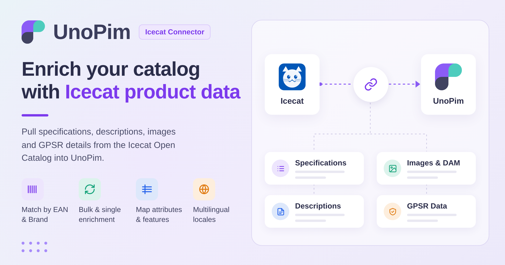

# UnoPim Icecat Connector

<div align="center">
  
</div>

<br>

The **UnoPim Icecat Connector** enriches your product catalog by pulling structured data directly from the [Icecat Open Catalog](https://icecat.us/). It imports specifications, descriptions, images, GPSR compliance details, and other product details to help you maintain accurate and consistent product information at scale.

Products can be enriched in bulk via the **Icecat Import Enrich Product** job, or individually from the product edit page via **More → Icecat Fetch**.

The connector is designed for **simple products** and matches Icecat content using unique identifiers such as EAN, Brand, or Product Code.

## How it works

```
  Icecat Credentials
         │
         ▼
  Attribute Mapping
  (EAN, Brand, Name, Images, GPSR…)
         │
         ▼
  Icecat Feature Mapping Import
  (downloads the full Icecat feature list)
         │
         ▼
  Feature Attribute Setup & Locale Mapping
  (select features, assign UnoPim attribute types, map locales)
         │
         ▼
  Icecat Attribute Import
  (auto-create UnoPim attributes from mapped features)
         │
         ▼
  ┌──────────────────────────────────────┐
  │         Product Enrichment           │
  │                                      │
  │  Bulk: Icecat Import Enrich Product  │
  │  Single: More → Icecat Fetch         │
  └──────────────────────────────────────┘
```

## Key features

- **Product matching via identifiers** — match products using EAN, Product Code, and Brand for accurate data enrichment.
- **Standard attribute mapping** — map core Icecat fields (EAN, Product Code, Vendor/Brand, Name, Title, Description, Short Description, Summary Description, Short Summary Description, Pictures, GPSR Compliance) to UnoPim attributes.
- **GPSR compliance data** — import Icecat's brand owner and EU representative details (name, address, contact) into a UnoPim textarea attribute.
- **Images, galleries, and DAM assets** — store Icecat pictures in an image or gallery attribute, or as assets in the UnoPim DAM when the DAM extension is installed.
- **Image reuse on re-runs** — pictures already stored from an earlier run are reused instead of being downloaded again, so repeat enrichments are faster.
- **Bulk feature mapping import** — download the full Icecat feature list into UnoPim via the Feature Mapping import job.
- **Feature attribute setup** — select required Icecat features and assign UnoPim attribute types (text, select, textarea, etc.) to capture specification data.
- **Attribute import** — auto-create UnoPim attributes from selected Icecat features in one job.
- **Bulk and single enrichment** — enrich products in bulk through a dedicated import job, or fetch data for a single product directly from its edit page.
- **Locale mapping** — map Icecat locales to UnoPim locales for multilingual product data enrichment.
- **Change history** — every change to a credential and its mappings is recorded in the credential's **History** tab.
- **Role-based access** — separate ACL permissions for credentials, attribute mapping, locale mapping, and history.
- **Simple product support** — focused, reliable enrichment for simple product types.

## Requirements

| Requirement | Version |
|---|---|
| **UnoPim** | 3.1.3 (compatible with 3.0.x and 3.1.x) |
| **PHP** | 8.4.1 or higher |
| **Laravel** | 13.x |
| **Icecat account** | An active [Icecat](https://icecat.us/) account (username and password) |
| **UnoPim DAM** | Optional, only needed to store Icecat pictures as DAM assets |

A running queue worker is required, because the bulk enrichment and import jobs are dispatched to the queue.

## In this guide

- [Installation](./installation)
- [Setup Icecat Credentials](./setup-credentials)
- [Attribute Mapping](./attribute-mapping)
- [Locale Mapping](./locale-mapping)
- [Import: Feature Mapping](./import-feature-mapping)
- [Import: Attributes](./import-attributes)
- [Import: Enrich Product](./import-enrich-product)
- [Single Product Fetch](./fetch-product)
