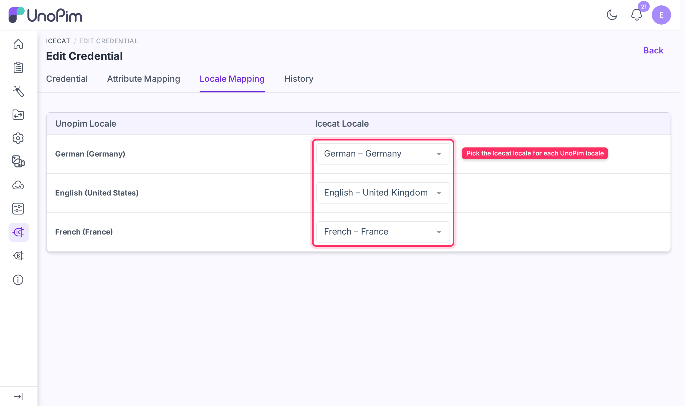

# Locale Mapping

The **Locale Mapping** tab on a credential maps each of your active UnoPim locales to an Icecat locale. The connector uses it to pick the language of Icecat feature labels when it downloads the feature list.

Open it from **Icecat → Credentials → Edit → Locale Mapping**.

## How the mapping screen works

The table lists every active UnoPim locale in the left column. For each row, select the corresponding Icecat locale from the dropdown on the right.

| Column | Description |
|---|---|
| **UnoPim Locale** | An active locale configured in your UnoPim installation (e.g., `English (United States)`). |
| **Icecat Locale** | The Icecat language variant to fetch content in (e.g., `English`). |

## Configure locale mapping

1. Navigate to **Icecat → Credentials → Edit → Locale Mapping**.
2. For each UnoPim locale you intend to enrich, select the matching Icecat locale from the dropdown.
3. Click **Save changes** in the **You have unsaved changes** bar at the bottom of the page.

Saved changes are recorded in the credential's **History** tab. Users without the **Icecat → Locale Mapping → Edit** permission see this tab read-only.

## How locale mapping is used

| Where | What decides the language |
|---|---|
| **Icecat Feature Mapping import** | The Icecat locale mapped here for the selected UnoPim locale. It sets the language of the feature labels shown in the **Select Feature Type** dropdown. If the locale is not mapped, the connector tries an Icecat locale with the same code, then falls back to English labels. |
| **Icecat Import Enrich Product** and **Single Product Fetch** | The language part of the selected UnoPim locale code. For example, `en_US` requests English (`en`) and `de_DE` requests German (`de`) content from Icecat. |

Product content is written to the UnoPim locale you select in the job or fetch dialog. If Icecat has no datasheet in that language for a product, the product is skipped and the reason is logged in the job with its SKU.

## What's next

- [Import: Feature Mapping](./import-feature-mapping) — download the Icecat feature list for a credential and locale.
- [Import: Enrich Product](./import-enrich-product) — run a bulk enrichment job using this locale mapping.
- [Single Product Fetch](./fetch-product) — fetch Icecat data for one product on demand.
