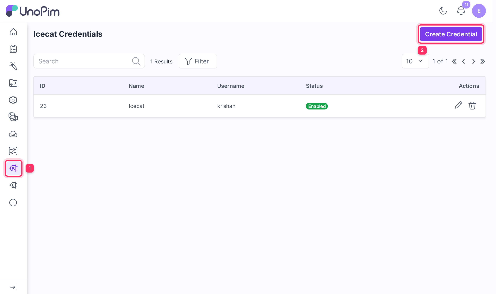
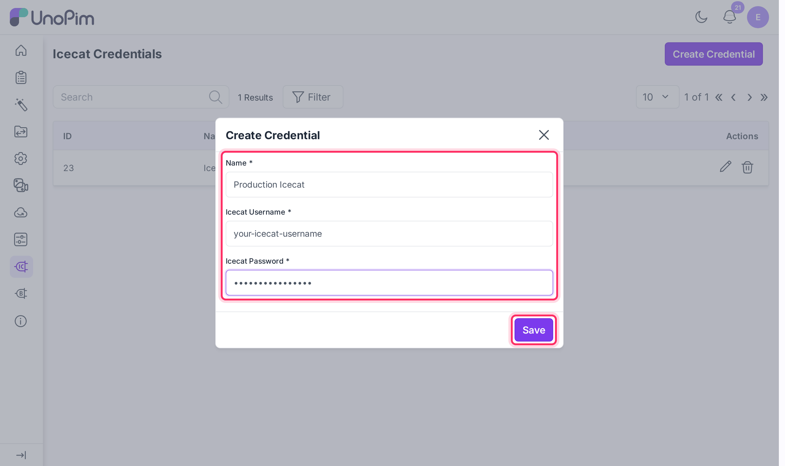
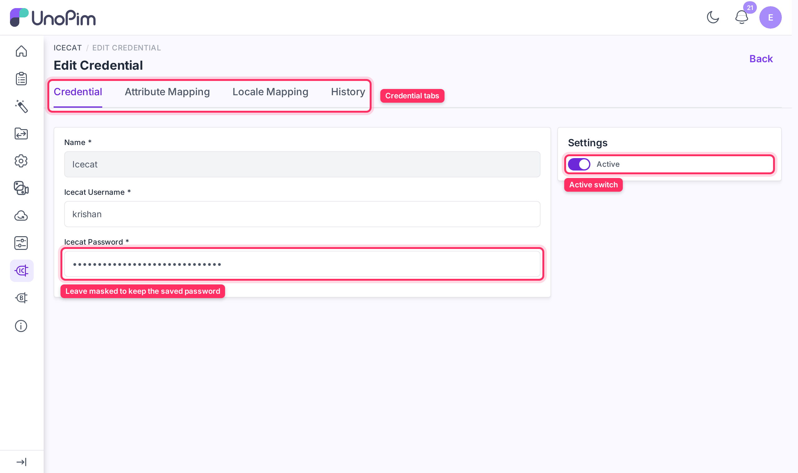
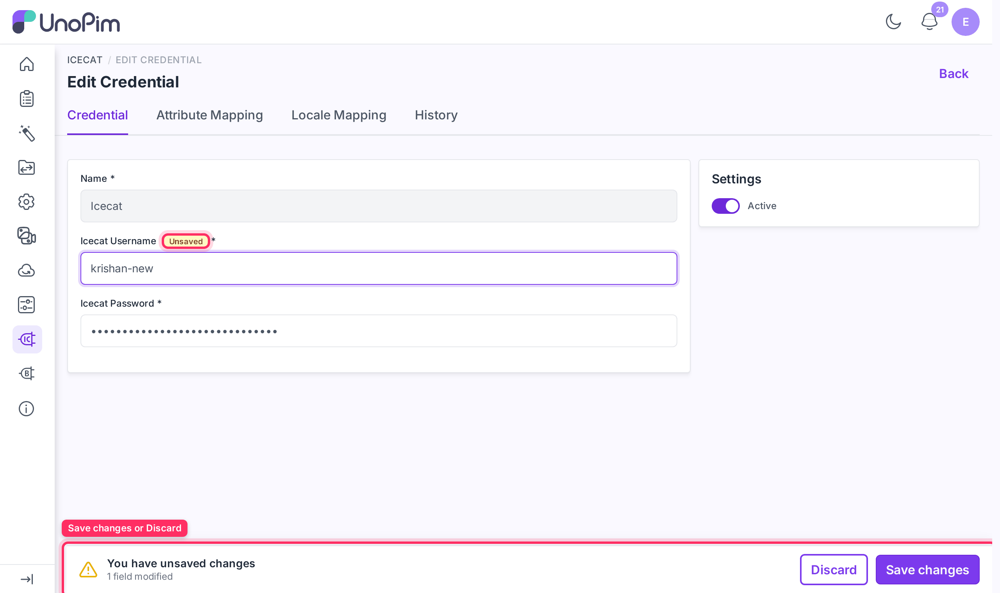
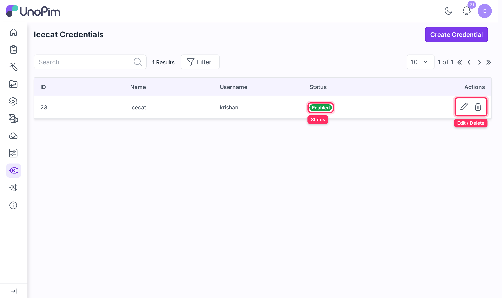

# Setup Icecat Credentials

Once the connector is installed, connect your Icecat account to UnoPim by creating a credential. Each credential stores your Icecat login details and holds all mapping configuration for that connection. You can create multiple credentials — one per Icecat account or use-case.

## Step 1 — Open the Credentials page

Log in to your UnoPim admin panel and navigate to **Icecat → Credentials**, then click **Create Credential**.

## Step 2 — Fill in your Icecat account details

| Field | What to enter |
|---|---|
| **Name** | A unique label for this connection (e.g., `Production Icecat`). Must be unique across credentials. |
| **Icecat Username** | Your Icecat account username. |
| **Icecat Password** | Your Icecat account password. Stored encrypted and never shown after saving. |

## Step 3 — Save the credential

Click **Save**. The credentials are validated live against the Icecat API before they are stored. If the username or password is incorrect, the form shows **"The provided credentials are invalid."** and nothing is saved. If Icecat cannot be reached at that moment, the form asks you to try again shortly instead of rejecting the credentials.

After saving, the credential opens on its edit page.

## The credential edit page

The edit page has three tabs, plus a **History** view:

| Tab | What it holds |
|---|---|
| **Credential** | Name, Icecat username and password, and the **Active** switch. |
| **Attribute Mapping** | Which UnoPim attributes receive Icecat data. See [Attribute Mapping](./attribute-mapping). |
| **Locale Mapping** | Which Icecat locale each UnoPim locale corresponds to. See [Locale Mapping](./locale-mapping). |
| **History** | A log of every change made to this credential and its mappings, with who made it and when. |

Tabs are shown only to users whose role has the matching Icecat permission.

### Saving changes

When you change a field on any tab, a **You have unsaved changes** bar appears at the bottom of the page and the changed fields are marked **Unsaved**. Click **Save changes** to store them, or **Discard** to revert. Switching tabs and returning keeps you on the page without a full reload.

### Editing the username or password

- The saved password is never shown. Leave the masked **Password** field as it is to keep the stored value.
- If you change only the **Username**, it is checked against Icecat with the stored password before it is saved.
- If you enter a new password, the new username and password pair is checked together.

## Managing credentials

Each credential appears as a row in the **Icecat → Credentials** grid with columns for **ID**, **Name**, **Username**, and **Status**. Click a row to open it.

| Action | How |
|---|---|
| **Edit** | Click the **Edit** action (or the row) to update the name, username, password, or active status, and to configure attribute and locale mappings. |
| **Delete** | Click **Delete** on a row to permanently remove the credential and all its mapping configuration. |
| **Activate / Deactivate** | Open the credential's **Credential** tab and toggle the **Active** switch. Only active credentials can be selected in import jobs and the single-product fetch. |

## What's next

After saving a credential, configure what Icecat data maps to which UnoPim attributes:

- [Attribute Mapping](./attribute-mapping) — map Icecat fields to UnoPim attributes.
- [Locale Mapping](./locale-mapping) — map Icecat locales to UnoPim locales.
