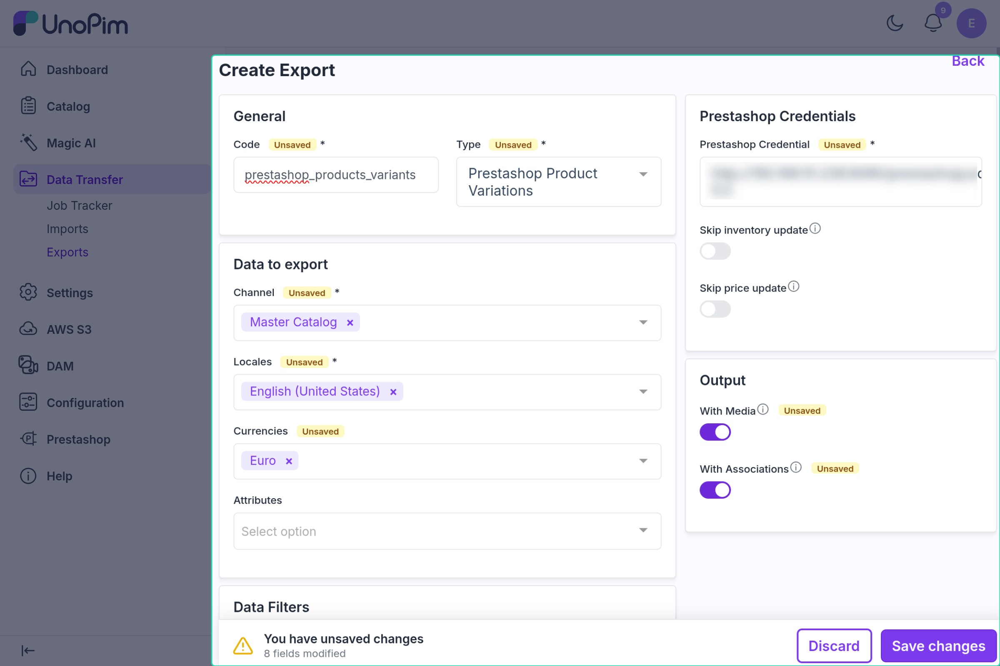

# Product Variant Export

The product variant export job exports UnoPim **variant products** as PrestaShop combinations. It works variant by variant - the filters apply to the variants themselves - and does not re-send the parent product's data.

---

## Configurable Product Export vs Product Variant Export

| | Configurable Product Export | Product Variant Export |
|---|---|---|
| **Loads** | Configurable (parent) products | Variant products |
| **Exports parent product** | Yes - name, price, descriptions, images, categories, features | No - only creates the parent if it is missing in PrestaShop |
| **Exports combinations** | Yes - every variant of each exported parent | Yes - only the variants matched by the filters |
| **Job count** | One per parent product | One per variant |
| **Use when** | First-time sync or parent details changed | Only variants changed (price, stock, options) |

---

## How to Run

1. Go to **Data Transfer → Exports → Create Export**.

2. Select type **Prestashop Product Variants**.

3. Set the filters. They are the same as for [Simple Product Export](./simple-product-export.md#product-export-filters), with these differences:

- **Identifiers**, **Status**, **Attribute Families**, and the other data filters match the **variants** - for example, paste variant SKUs to export only those combinations.
- **Categories** matches the categories of the variant's **parent** product.
- The variant is sent to the shops its parent belongs to, based on the parent's categories.

4. Save and run the job.

---

## What Gets Exported Per Variant

| Field | Notes |
|---|---|
| **Reference** | The variant's own SKU |
| **Price impact** | Variant price minus parent price |
| **Ecotax** | If Ecotax is mapped |
| **Quantity** | Variant stock |
| **Option values** | e.g. Color: Red, Size: M - from the configurable product's variant attributes |
| **Images** | With **With Media** on - uploaded to the parent product and assigned to the combination |

**Skip price update** leaves the price impact and ecotax of existing combinations unchanged, and **Skip inventory update** leaves their stock unchanged.

---

## Create vs Update

| Situation | What happens |
|---|---|
| Parent product missing in PrestaShop | Parent is **created first** (logged in the job), then the combination |
| Combination not in PrestaShop | **Created** and linked to the parent |
| Combination already exported | **Updated** |
| Saved combination ID missing in PrestaShop | **Recreated** |

---

## Prerequisites

Option groups and values (e.g. "Color", "Red") that do not exist in PrestaShop yet are created automatically. For translated option names and complete parent data, run jobs in this order:

1. Attribute Export
2. Category Export
3. Configurable Product Export *(first time)*
4. **Product Variant Export** *(for variant-only updates after that)*

---

## Common Issues

| Issue | Fix |
|---|---|
| *"Configurable parent not found for variant … Skipping."* | The variant must belong to a configurable parent |
| *"No option values resolved for variant … Skipping combination export."* | Give the variant a value for each variant attribute of its parent |
| Price impact looks wrong | It is the difference between variant and parent price - check both prices |
| Variant images missing | Turn on **With Media** and add the image attribute in Images Mapping |
