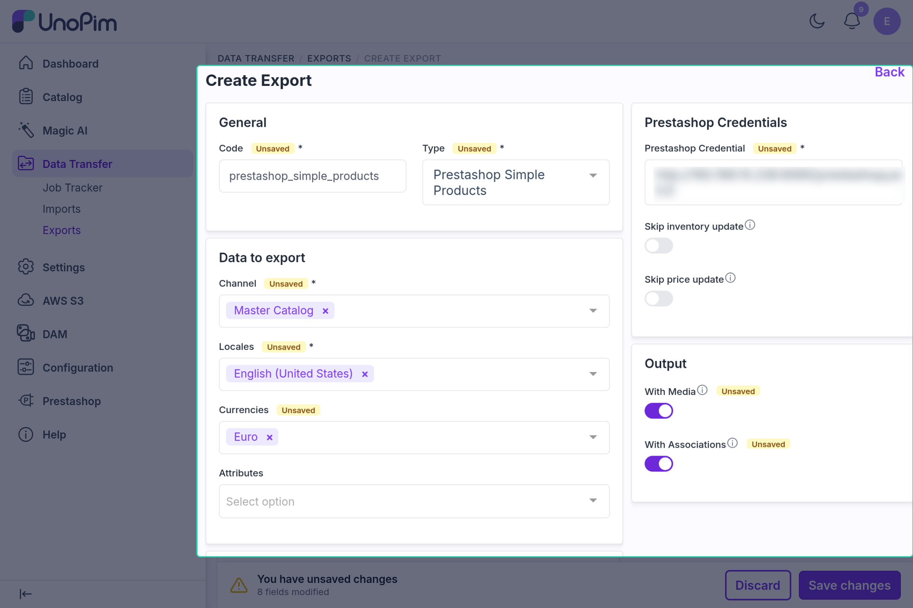

# Simple Product Export

The simple product export job pushes UnoPim simple products (without a parent) to PrestaShop. Each product is created or updated through the PrestaShop WebService API.

---

## Before You Start

- Complete the credential's [Shop Mapping](./shop-channel-mapping.md).
- Map **Name** and **Price** (an attribute or a default value) in the [Attribute Mapping](./attribute-mapping.md) tab. Without them the job cannot be saved: *"The Attribute Mappings are not set. Please map the attributes in the Attribute Mapping tab of the credential first."*
- Run [Category Export](./category-export.md) and [Attribute Export](./attribute-export.md) first, so categories and features exist in PrestaShop.

---

## How to Run

1. Go to **Data Transfer → Exports → Create Export**.

2. Select type **Prestashop Simple Products**.

3. Set the filters (described below).

4. Save and run the job.

---

## Product Export Filters

These filters are the same for the simple, configurable, and variant product export jobs.

### Prestashop Credentials

| Field | What it does |
|---|---|
| **Prestashop Credential** | Your PrestaShop connection — required. Only enabled credentials are listed |
| **Skip inventory update** | Leaves the stock of products already in PrestaShop unchanged. New products still get their quantity |
| **Skip price update** | Leaves the price and ecotax of products already in PrestaShop unchanged. New products still get their price |

### Data to export

| Field | What it does |
|---|---|
| **Channel** | One or more channels mapped in the credential's Shop Mapping — required. The product is sent to every shop mapped to these channels |
| **Locales** | Locales to export, from those mapped for the selected channel — required |
| **Currencies** | Optional. Lists the currencies of the shops mapped to the selected channels; shops whose currency is not selected are skipped |
| **Attributes** | Optional. Export only these mapped attributes. Price is always sent (unless **Skip price update** is on), and Name, Link Rewrite, and Reference are also sent for new products. Features already on the product are kept |

### Data Filters

| Field | What it does |
|---|---|
| **Attribute Families** | Only products in these families |
| **Status** | Enable, Disable, or All |
| **Completeness** | No condition, complete on at least one selected locale, or complete on all selected locales |
| **Time Condition** | No date condition, updated over the last N days, updated since last export, or updated between two dates |
| **Categories** | Only products in the selected categories |
| **Identifiers** | Paste one SKU per line to export only those products |

**Attribute Conditions** — optional rules on attribute values; only products matching every condition are exported.

### Output

| Field | What it does |
|---|---|
| **With Media** | Upload product images and attachments to PrestaShop. Off by default |
| **With Associations** | Send related, up-sell, and cross-sell products as PrestaShop accessories. Targets not yet exported are skipped. Off by default |

---

## What Gets Exported

| Field | Notes |
|---|---|
| **Name, Description, Short Description** | Localized per mapped language. Short Description is cut to 779 characters |
| **Meta Title, Meta Description, Link Rewrite** | Localized; Link Rewrite is generated from the name if not mapped. Meta Description has HTML removed and is cut to 512 characters |
| **Price** | Required — the product is skipped if it has no price. Sent in the currency of each shop |
| **Ecotax** | If mapped — see [Attribute Mapping](./attribute-mapping.md#notes-on-specific-fields) |
| **Reference** | The product SKU, unless **Reference** is mapped |
| **Ean13, Upc** | If mapped. Ean13 is cut to 13 characters; Upc keeps digits only and is skipped if longer than 12 digits |
| **Width, Height, Depth, Weight** | If mapped |
| **Brand (Id Manufacturer)** | If mapped — the brand is found by name in PrestaShop, or created |
| **Active, Visibility** | Active and visible everywhere unless mapped |
| **Tax rules group** | Always sent; `0` (no tax) when not mapped |
| **Quantity** | Set as the product's stock after the product is saved |
| **Categories** | Linked to categories already exported to PrestaShop. The default category is the first exported category; if none are found, the PrestaShop shop's root category (usually Home) is used |
| **Features** | Values of the feature attributes from the Other Mapping tab — predefined values for select attributes, a custom value for text attributes |
| **Images and attachments** | With **With Media** on — the main and additional images from Images Mapping. Image files from DAM asset attributes become images; other DAM files become PrestaShop attachments |
| **Accessories** | With **With Associations** on — related, up-sell, and cross-sell products |

Only mapped fields and default values are sent; no other attributes are exported. See [Attribute Mapping](./attribute-mapping.md) for the list of fields sent.

Features are linked only when the feature already exists in PrestaShop, so run [Attribute Export](./attribute-export.md) after adding a feature attribute.

---

## Create vs Update

| Situation | What happens |
|---|---|
| Product exported before | **Updated** using the saved PrestaShop ID |
| Not exported before, but a PrestaShop product has the same reference (SKU) | That product is **updated** and linked |
| No match found | **Created**; its ID is saved |
| Saved ID no longer exists in PrestaShop | **Recreated** |

With several shops mapped to the selected channels, the product is created in the first shop and then updated for each other shop with that shop's currency and languages.

A product is sent only to shops whose **Root Category** (from Shop Mapping) contains at least one of its categories. If no shop matches, the job log shows *"Skipping product … : none of its categories belong to the root category of a selected shop."* Products without categories go to shops that use the default channel's root category.

---

## Images

With **With Media** on, images are uploaded after the product is saved:

- The main image and additional images come from **Other Mapping → Images Mapping**. The main image becomes the cover image in PrestaShop.
- Images are uploaded to each shop the product is sent to.
- Images already in PrestaShop are not uploaded again.
- Image order follows UnoPim. If the order changes in UnoPim, the out-of-order images are deleted and uploaded again on the next export, so the PrestaShop order and cover match. The job log shows *"Image … is out of order for SKU …. Re-uploading to apply UnoPim image order"*.
- Images and attachments removed in UnoPim are deleted from PrestaShop on the next export.

---

## Common Issues

| Issue | Fix |
|---|---|
| Job cannot be saved — *"The Attribute Mappings are not set…"* | Map **Name** and **Price** in Attribute Mapping |
| Product skipped — *"Product price is required field."* | Give the product a price, or set a Price default value |
| Product skipped — *"none of its categories belong to the root category of a selected shop"* | Assign a category under the shop's Root Category, or check the Root Category in Shop Mapping |
| Categories not linked | Run **Category Export** first |
| Features missing | Run **Attribute Export** first so the feature exists in PrestaShop |
| Tax rule removed in PrestaShop | Map **Id Tax Rules Group** — without it the product is sent with no tax rule |
| Ecotax not visible in PrestaShop | Turn on **Use ecotax** under **International → Taxes** for that shop |
| Images not uploading | Turn on **With Media** and add an image attribute in Images Mapping |
| Names blank in PrestaShop | Make sure the selected locales have values in UnoPim |
