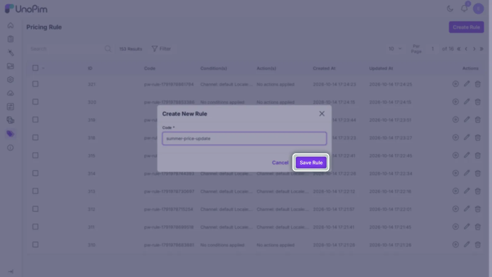
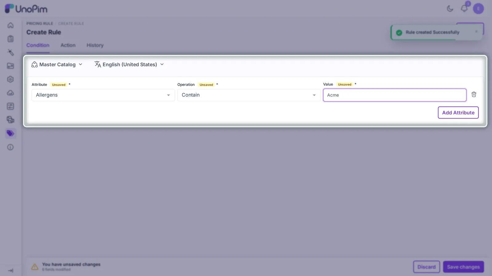
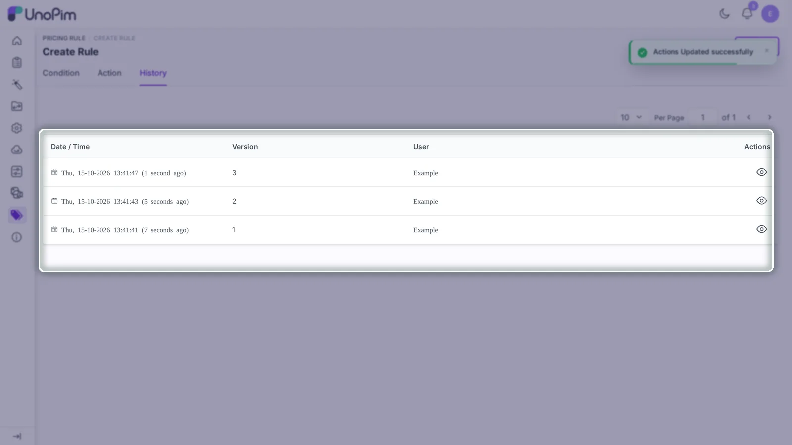

# Author Guide

A **Rule Author** is any admin user with `create` and `edit` permissions on the Dynamic Pricing Rule module. Authors define what each rule does: its code, conditions, and actions, but do not necessarily run it.

## Opening the module

In the admin panel, click **Pricing Rule** in the sidebar. The listing page shows every saved rule with a summary of its conditions and actions, and is the entry point for creating new ones.

::: tip
A rule without saved conditions or saved actions is considered incomplete. Incomplete rules can still be opened for editing but cannot be executed. The Execute button is disabled for them.
:::

## Creating a rule

### Step 1: Enter the rule code

1. Click **Create Rule** on the listing page.
2. A modal dialog opens. Enter a unique **Code**.
3. Click **Save** in the modal.

The code must contain only letters, digits, and hyphens (no spaces or special characters). Use a descriptive, business-meaningful code, for example:

```text
summer-price-update
b2b-price-usd-update
channel-sale-price
```

After saving, Unopim navigates you to the rule editor where conditions and actions are configured.



### Step 2: Configure conditions

The **Condition** tab decides which products a rule applies to.

1. Open the **Condition** tab (it is selected by default when entering the editor).
2. Choose the required **Channel** using the channel switcher at the top of the tab.
3. Choose the required **Locale** using the locale switcher.
4. Click **Add Attribute**.
5. Fill in the condition row:
   - **Attribute**: any product attribute available in Unopim
   - **Operation**: `Contain` or `Is Equal to`
   - **Value**: the text value to match
6. Repeat **Add Attribute** to add more condition rows.
7. Click **Save** in the page save bar (top of the editor).

::: warning
Conditions are saved per channel/locale pair. Switching channel or locale shows the conditions stored for that combination. If you switch while there are unsaved changes, the editor prompts you to confirm, because switching discards unsaved changes in the current view.
:::

#### Example condition setups

| Use case | Attribute | Operation | Value |
|---|---|---|---|
| Products whose brand contains "Acme" | `brand` | Contain | `Acme` |
| Products with status exactly `active` | `status` | Is Equal to | `active` |
| Specific SKU | `sku` | Is Equal to | `ABC-123` |

To remove a condition row, click the delete icon at the end of the row.



### Step 3: Configure actions

The **Action** tab defines what gets written to matching products.

1. Switch to the **Action** tab.
2. Choose the required **Channel** and **Locale** using the switchers.
3. Click **Add Attribute**.
4. Fill in the action row:
   - **Attribute**: a product attribute of type `price`
   - **Currency**: one of the currencies assigned to the selected channel
   - **Value**: the numeric amount to write (must be zero or positive)
5. Repeat **Add Attribute** to add more action rows.
6. Click **Save** in the page save bar.

#### Example action setup

- Attribute: `price`
- Currency: `EUR`
- Value: `499`

This writes `499` into the `price` attribute for every matching product under the selected channel + locale + EUR path.


::: warning
The action assigns the exact value you enter. It is a direct price assignment, not a formula-based discount. The value is written as-is to the target attribute.
:::

## Editing a rule

1. Open **Pricing Rule** and click the **Edit** icon on the rule row.
2. The rule editor opens with the **Condition** tab active.
3. Modify conditions or actions on the respective tab.
4. Click **Save** in the page save bar to apply changes, or **Discard** to revert to the last saved state.

The editor stays on the active tab after saving. There is no page reload or redirect.

## Viewing rule history

Switch to the **History** tab inside the rule editor to see a timeline of every change made to the rule, including who made the change and when. This tracks modifications to the rule's code, conditions, and actions.

History records show the values that changed, making it easy to correlate "who edited this rule before last night's run."



## Deleting a rule

- **Single delete**: click the **Delete** icon on the rule row in the listing.
- **Mass delete**: select multiple rows and choose **Delete** from the mass-action dropdown.

Deleted rules are removed from the listing and cannot be executed.

## What authors should not do

- Edit the wrong channel/locale by mistake: always verify the channel and locale switchers before modifying conditions or actions.
- Mix unrelated business logic in one rule: keep one purpose per rule (one channel sale, one B2B update, etc.).
- Leave the Action tab empty. A rule without an action does nothing and cannot be executed.
- Use spaces or special characters in the rule code: only letters, digits, and hyphens are accepted.

## Best practices

1. Author a small test rule first and run it on known products before scaling up.
2. Use a clear, namespaced code such as `b2b-price-usd-update` instead of generic names like `rule1`.
3. Keep one business purpose per rule.
4. Verify the channel, locale, and currency on every action row before saving.
5. Make sure the price-type attribute already exists in Unopim before adding it to an action.
6. After saving both tabs, confirm the rule is executable by checking that both the Condition and Action summaries appear in the grid row.
