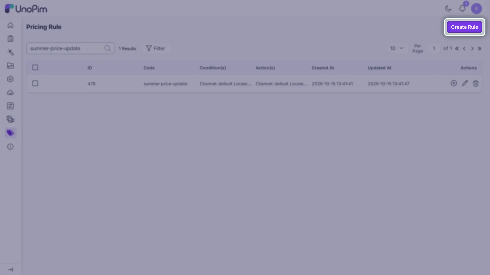

# Dynamic Pricing Rule

The **Dynamic Pricing Rule** extension adds a flexible, rule-based pricing engine to Unopim. Instead of editing prices product by product, you create reusable rules that update a price-type attribute in bulk based on configurable conditions, channel, locale, and currency.

## How it works

```
Author creates a rule (unique Code)
        ↓
   Add Conditions (per channel + locale)
        ↓
   Add Actions (price attribute + value + currency)
        ↓
Execute rule from grid, rule editor, or Artisan
        ↓
 Queue job finds matching products
         ↓
 Chunks of 100 update target price values
```

Each rule run is dispatched as a queue job and tracked in **Data Transfer > Job Tracker** as a system job, with its state, progress, updated/skipped counts, and a downloadable log. High-level messages are also written to the Laravel log.

## Key features

- **Condition-based engine**: target products by SKU, attribute values, or any other product attribute available in Unopim.
- **Action-based price assignment**: write a numeric value into a chosen price-type attribute when conditions are met.
- **Channel & locale aware**: conditions and actions are saved separately per channel/locale combination.
- **Currency-specific values**: set the price for any currency assigned to the selected channel.
- **Operators**: `Contain` and `Is Equal to` matching for condition values.
- **Single or mass execute**: run one rule from its row action or from inside the rule editor, or select multiple rules and use **Mass Execute**.
- **Artisan command**: execute any rule by ID from the CLI: `php artisan unopim:price-rule:run {rule_id} {admin_email?}`. The optional admin email is shown against the run in the Job Tracker.
- **Queue-based processing**: `ApplyPriceRule` and `ApplyPriceRuleToProducts` jobs handle product matching and updates in batches of 100.
- **History tab**: every saved rule has its own change history visible inside the editor.
- **Execution logs**: every run appears in **Data Transfer > Job Tracker** with a downloadable log, plus a per-run log file at `storage/logs/rule-tracker/{execution_id}/rule.log`.
- **Permission-based access**: view, create, edit, delete, mass-delete, and execute are individually controlled via admin roles.

## Roles

| Role | Responsibilities |
|---|---|
| **Rule Author** | Creates rule codes, configures conditions and actions per channel/locale |
| **Rule Operator** | Executes rules from the grid, editor, or Artisan and monitors logs |

A user can hold both roles depending on their permissions.



## Requirements

- Unopim v3.0.0 or later (tested on v3.1.3)
- PHP 8.4+, Laravel 13.x, Concord ^1.16
- Queue worker running (rule execution is dispatched as queue jobs)
- Price-type attributes already created in Unopim

## In this guide

- [Installation](./installation)
- [Configuration](./configuration)
- [Author Guide](./author-guide)
- [Operator Guide](./operator-guide)
