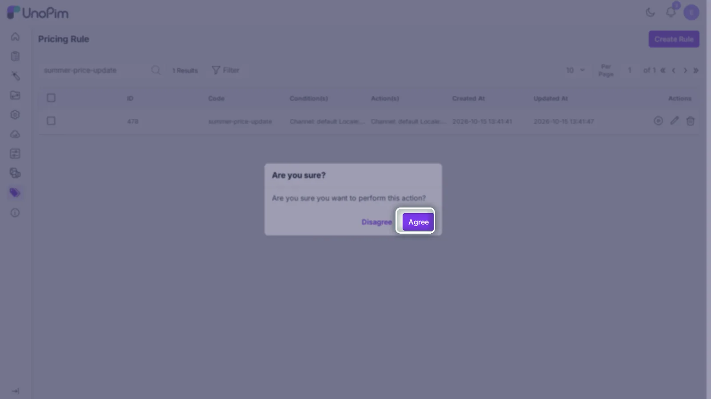
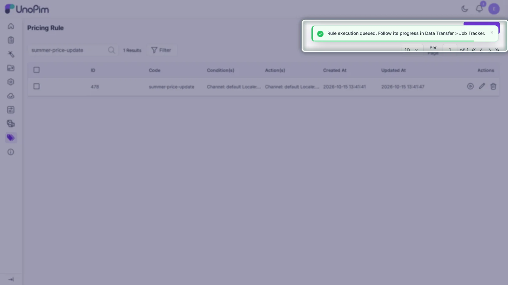
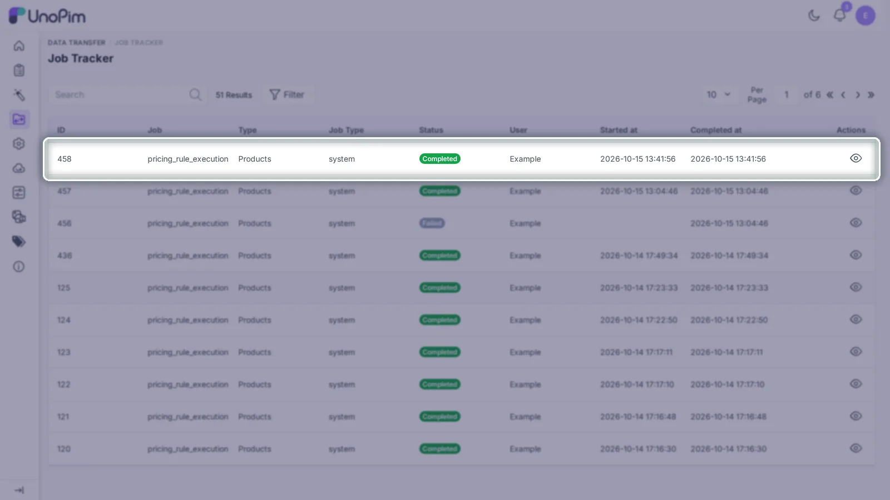
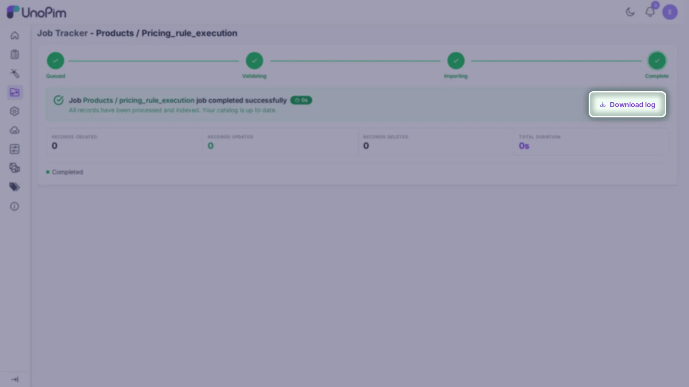

# Operator Guide

A **Rule Operator** is an admin user who runs saved pricing rules and verifies the results. This guide covers how to execute rules, monitor their progress, and read the logs they produce.

::: warning
Only users with the `pricingrulemodule.execute` permission can run rules. The Execute button and the play icon in the grid are hidden for users without this permission.
:::

## Running rules from the admin grid

Navigate to **Pricing Rule** in the sidebar to open the listing page. Two execution paths are available from the grid:

### Run a single rule

Click the **play** icon on the rule's row. The controller dispatches the `ApplyPriceRule` job to the queue and returns a confirmation that the run is queued, with a link to follow its progress in **Data Transfer > Job Tracker**.



### Run multiple rules together

1. Select the checkbox on each rule you want to run.
2. Open the mass-action dropdown.
3. Choose **Mass Execute**.

Each selected rule is dispatched as its own job. They do not run sequentially or share state. If some selected rules are incomplete (missing conditions or actions), those are skipped. The response message reports how many rules were dispatched and how many were skipped. If none of the selected rules can run, the request is rejected with an error instead.

## Running a rule from the rule editor

An **Execute** button appears in the page header while you are inside the rule editor (on both the Create and Edit screens). Clicking it dispatches the rule immediately without leaving the editor. This is useful for testing a rule right after saving new conditions or actions.

The button is disabled while a dispatch is in progress to prevent double submission.



## Running rules from the CLI

The module provides one Artisan command:

```bash
php artisan unopim:price-rule:run {rule_id} {admin_email?}
```

Example:

```bash
php artisan unopim:price-rule:run 5 admin@example.com
```

What the command does:

- Accepts one required argument: `rule_id`.
- Accepts one optional argument: the email of an admin user. The run is attributed to that admin in the Job Tracker.
- Stops with an error, without queuing anything, when the rule ID does not exist or when the email matches no admin user.
- Dispatches the `ApplyPriceRule` job to the queue.
- Prints a confirmation message in the terminal.

The command returns immediately: actual product updates happen asynchronously in the queue worker.

## What happens after execution

```
Operator triggers run (grid action / editor button / mass execute / CLI)
        ↓
Controller or command checks rule is executable (has conditions + actions)
        ↓
ApplyPriceRule job dispatched to queue
        ↓
 ApplyPriceRule finds matching products using the rule's conditions
         ↓
 Product IDs are split into batches of 100
         ↓
 Each batch dispatches ApplyPriceRuleToProducts
         ↓
 Batch job writes the action value into each product's price attribute
         ↓
 Run tracked in Data Transfer > Job Tracker, log written at storage/logs/rule-tracker/{execution_id}/rule.log
```

Because everything runs through the queue, the queue worker **must** be active. Without it, jobs sit unprocessed and no product values change.

## Monitoring execution

### Job Tracker

This is the primary place to follow a run. Open **Data Transfer > Job Tracker**: every execution appears there as a `system` job with its current state, progress, total products updated and skipped, the reason each product was skipped, and a downloadable log. The run is attributed to the admin who triggered it.



### Per-execution log files



Every run creates its own log folder:

```text
storage/logs/rule-tracker/{execution_id}/rule.log
```

Open the latest folder to see what the run did: which products were matched, which attributes were updated, and any errors that occurred per product. Per-product failures are logged and skipped without aborting the rest of the batch.

### Default Laravel log

High-level messages also appear in `storage/logs/laravel.log` (or wherever your default channel writes). Use this to spot failed jobs or queue exceptions.

### Rule history tab

Each rule has a **History** tab in its editor. This tracks changes to the rule record itself (conditions/actions edited, code changed), not individual run results: useful when correlating "this rule was changed before today's run."

## Verifying a run

After a run completes:

1. Open one of the products you expected to be affected.
2. Switch to the channel, locale, and currency targeted by the rule's action.
3. Confirm the price attribute shows the new value.

If the value did not update, check the troubleshooting section below.

## Troubleshooting

### Rule runs but no products are updated

Check, in order:

1. The rule has both saved conditions **and** saved actions. Incomplete rules are rejected at dispatch time.
2. The condition attribute names exactly match the attributes used on your products.
3. The chosen channel and locale match real product data.
4. The queue worker is running (`php artisan queue:work`).
5. The action attribute is a valid `price`-type attribute.

### Execution is rejected with an error

The Execute button shows an error flash if the rule is not executable. This happens when either conditions or actions are missing. Save both tabs in the rule editor before trying again.

### Rule execution starts but changes do not appear

Check:

1. The price value is being saved on the expected channel + locale + currency path.
2. The queue worker processed the job (check `storage/logs/laravel.log` for job failures).
3. No later process (import, another rule, an observer) is overwriting the value after the job completes.

### Condition matching feels too limited

Expected. The current version supports only:

- `Contain`: partial, case-insensitive match
- `Is Equal to`: exact, case-insensitive match

Operators like greater-than, less-than, range, or category-based matching are not available in the current release.

### A rule cannot be executed

Incomplete rules are still listed in the grid: their Conditions/Actions columns show a placeholder instead of a summary. But the Execute button and the play icon are rejected with an error for them. If a rule cannot run, open it in the editor and save both the Condition and Action tabs first.

## What operators cannot do

- Edit a rule's conditions or actions: that requires the `pricingrulemodule.edit` permission.
- Pause or cancel a queued run from the UI: once dispatched, stop the queue worker (or wait for the job to finish) to halt processing.
- Roll back a run automatically. There is no undo. Restore product prices manually or by running a corrective rule.

## Best practices

1. Always run a new rule against a known, small product set first before applying it to your full catalog.
2. Watch the queue worker (`php artisan queue:work`) when running large rules: failures show up immediately.
3. Review the run in **Data Transfer > Job Tracker** after large runs to confirm all products were processed: the downloadable log there covers the same ground as `storage/logs/rule-tracker/{execution_id}/rule.log`.
4. Back up product price data before bulk runs in production.
5. Keep queue workers monitored under a process supervisor in production.
