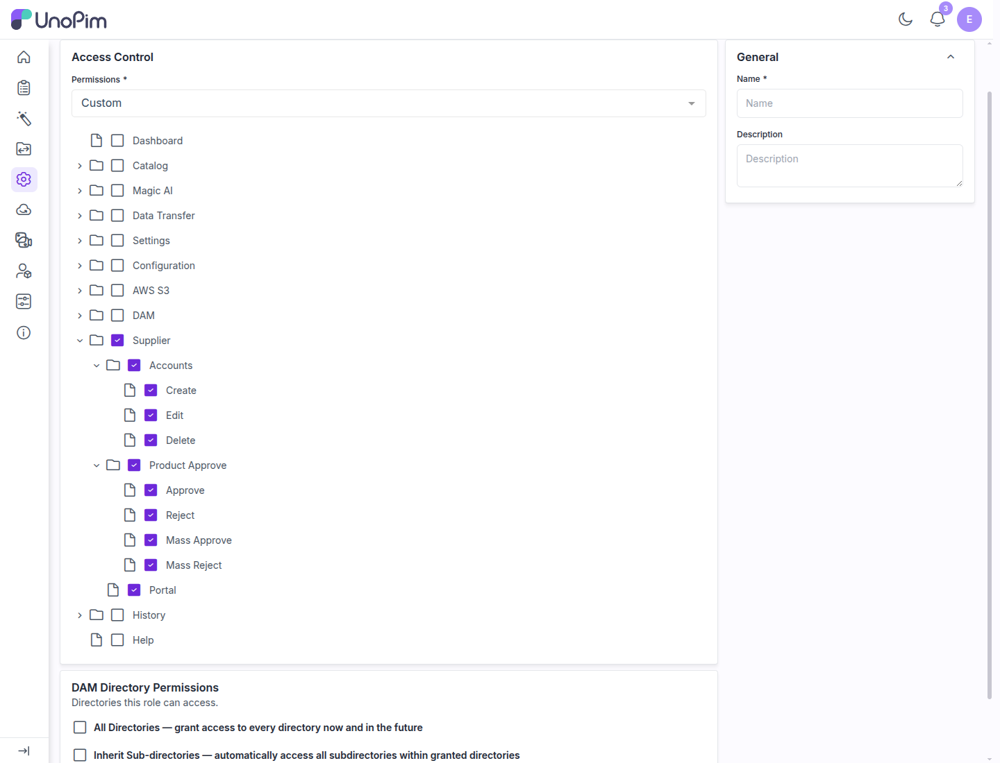
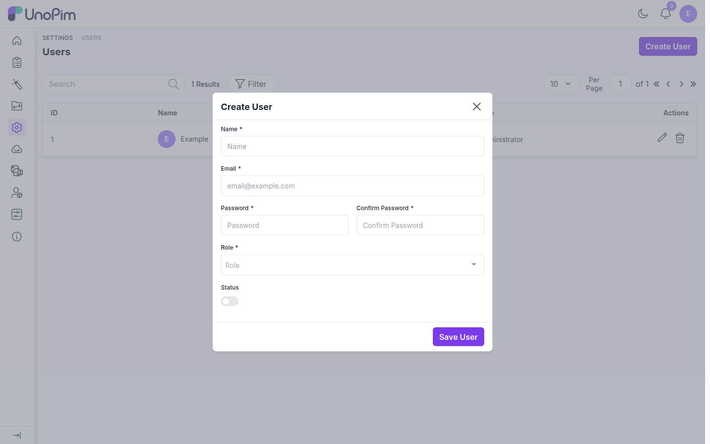
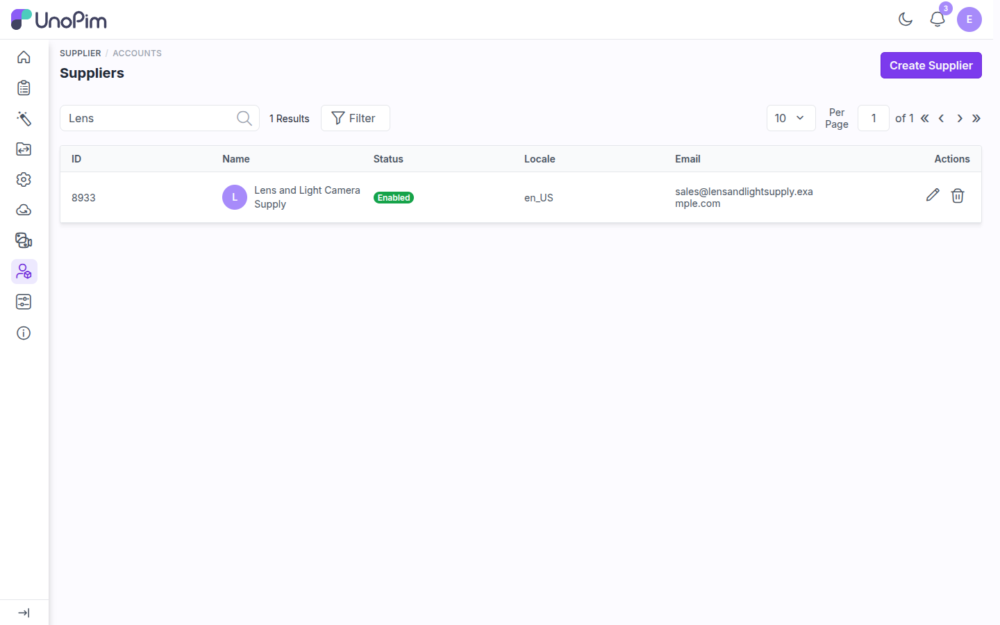
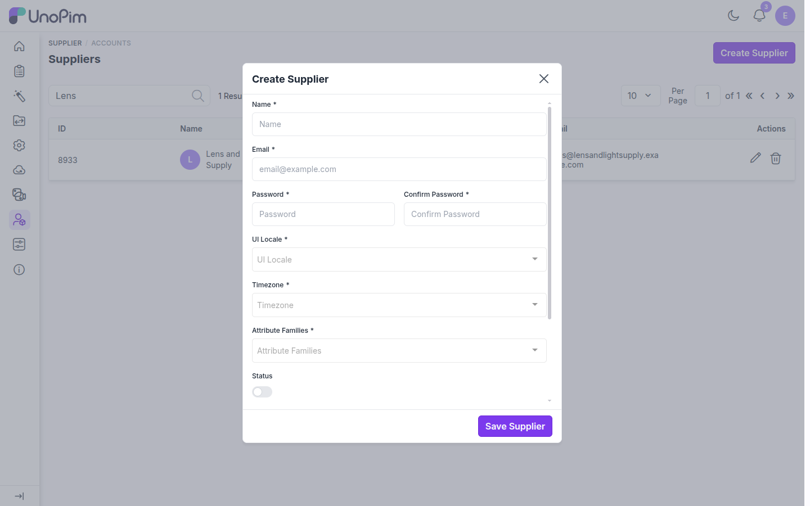
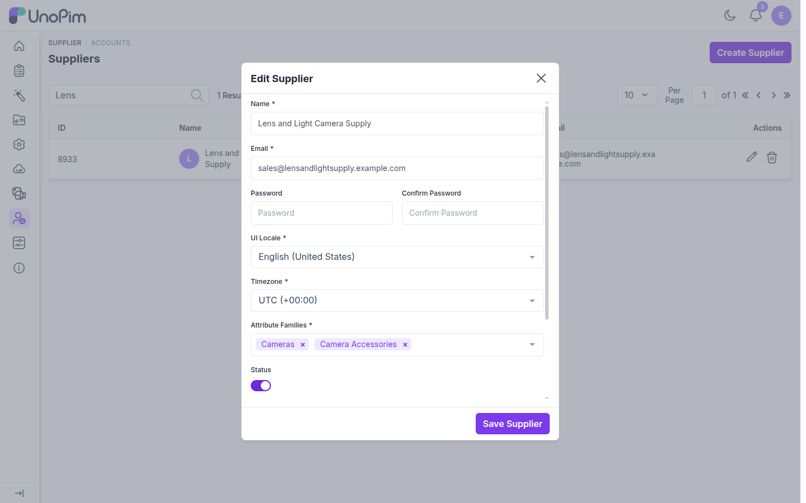
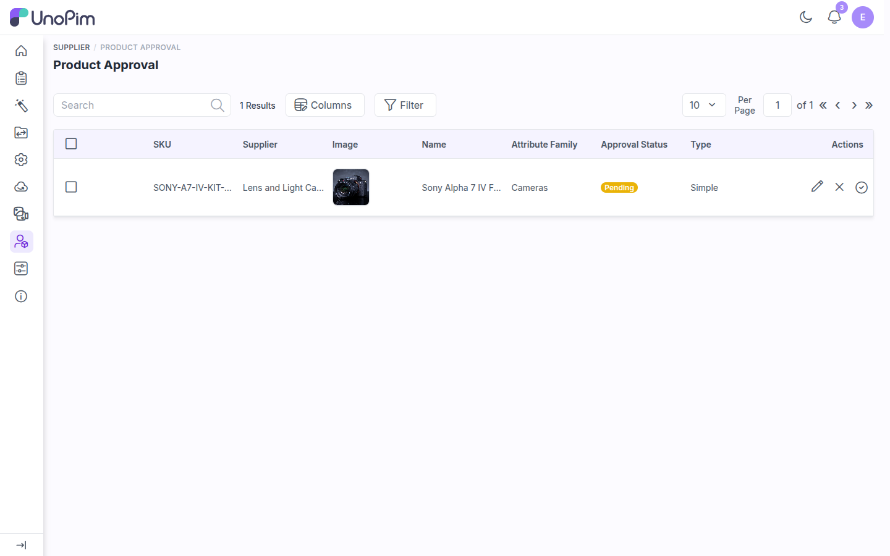
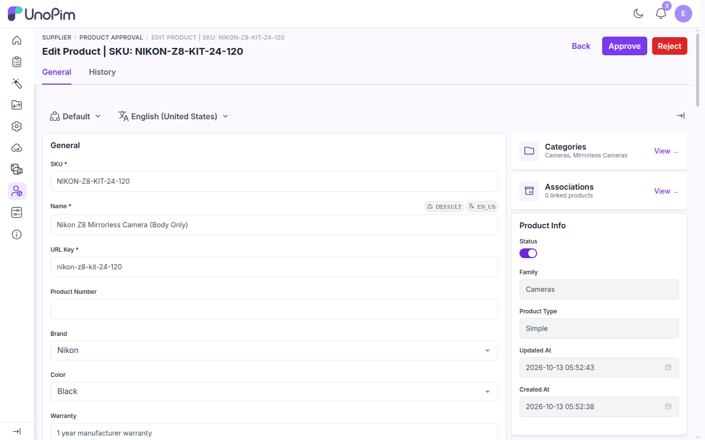
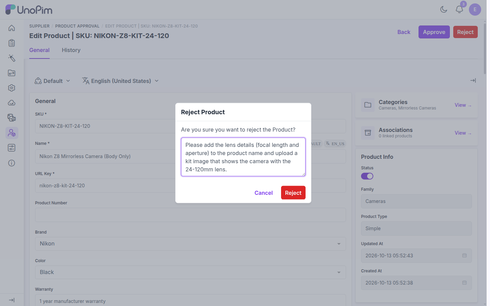
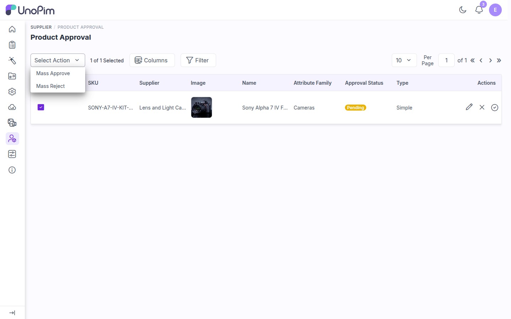

# Admin Guide

This guide covers what your team does to set up and run the Supplier Data Portal: creating a handler role and user, adding supplier accounts, and reviewing the products suppliers submit.

After installation, the UnoPim admin sidebar has a **Supplier** menu with three entries:

| Menu entry | What it opens |
|---|---|
| **Accounts** | The list of supplier accounts, where you create, edit and delete suppliers |
| **Product Approval** | The products waiting for review |
| **Portal** | The supplier sign-in page, in a new tab |

---

## Step 1: Create a supplier handler role

A **Super Admin** (a role with the **All** permission) already has every supplier permission and can skip to [Step 4](#step-4-create-supplier-accounts). To let other team members manage suppliers, create a dedicated role.

Go to **Settings → Roles → Create Role**, keep **Permissions** set to **Custom**, and expand **Supplier** in the permission tree.

| Permission | What it allows |
|---|---|
| **Supplier → Accounts** (Create, Edit, Delete) | View the supplier list and manage supplier accounts |
| **Supplier → Product Approve** | Open the **Product Approval** page and review products |
| **Product Approve → Approve** / **Reject** | Approve or reject a single product |
| **Product Approve → Mass Approve** / **Mass Reject** | Approve or reject several products at once |
| **Supplier → Portal** | Show the **Portal** link in the sidebar |

Also grant **Dashboard** and **Catalog** if the handler should see the UnoPim dashboard and the products that end up in the catalog. Enter a **Name**, then click **Save Role**.

---

## Step 2: Assign the role to a handler user

Go to **Settings → Users → Create User** (or edit an existing user), fill in the user's details, select the role from Step 1 in **Role**, turn **Status** on and click **Save User**. This user is your **supplier handler**.

---

## Step 3: Sign in as the supplier handler

Sign in to the UnoPim admin panel with the handler's email and password. The sidebar shows only the menus the role allows, including the **Supplier** menu.

---

## Step 4: Create supplier accounts

Go to **Supplier → Accounts** and click **Create Supplier**.

Fill in the form:

| Field | What to enter |
|---|---|
| **Name** | The supplier's company or contact name |
| **Email** | The email address the supplier signs in with |
| **Password** / **Confirm Password** | The supplier's first password. They can change it later from **My Account**. |
| **UI Locale** | The language of the supplier portal for this supplier |
| **Timezone** | The supplier's timezone |
| **Attribute Families** | One or more families the supplier can create products in |
| **Status** | Turn on to let the supplier sign in. A disabled supplier cannot sign in. |

Click **Save Supplier**. To change a supplier later, click the edit icon in the list. Leave the password fields empty to keep the current password.

---

## Step 5: Share the sign-in details with the supplier

Send each supplier:

- **Portal URL**: `https://your-domain.com/supplier/login` (also opened by **Supplier → Portal**)
- **Email**: the email you entered for the account
- **Password**: the password you set

Suppliers who forget their password can reset it with **Forget Password?** on the sign-in page.

---

## Step 6: Review submitted products

Go to **Supplier → Product Approval**. The page lists every product with the **Pending** status, with its supplier, image, attribute family and type.

Each row has three actions: **edit** (pencil), **reject** (cross) and **approve** (tick).

### Review and approve one product

Click the edit icon to open the product. You can check every attribute, switch channel and locale, look at the **History** tab, and correct values before you decide. Click **Approve** to accept the product, or **Reject** to send it back.

When you approve a product, it is copied into the UnoPim catalog (**Catalog → Products**). For a configurable product, its variants are copied too.

### Reject with a message

Click **Reject**, write what the supplier needs to change, and confirm. The product's status changes to **Rejected**, and the supplier gets a notification and sees your message on the product's edit page.

Write the message as an instruction the supplier can act on, for example "Add the lens focal length and aperture to the product name".

### Mass approve or mass reject

Select several products with the checkboxes, open **Select Action**, and choose **Mass Approve** or **Mass Reject**. This is useful for large batches from one supplier, such as after an import.

---

## Step 7: After the review

- **Approved** products are in the UnoPim catalog and leave the **Product Approval** list.
- **Rejected** products also leave the list until the supplier fixes and saves them.
- When a supplier saves any change, including a fix to a rejected product or an update to an approved one, the product returns to **Pending** and appears on **Product Approval** again. An approved product's catalog copy is updated when you approve it again.

> **Tip:** Check **Product Approval** regularly, or after a supplier tells you an import has finished.
