# Supplier Guide

This guide is for **suppliers**: the people or companies who submit product data through the UnoPim Supplier Data Portal. Your portal is a separate, focused space for your own products. You don't need to know anything about the UnoPim admin panel.

---

## Step 1: Sign in

Open the portal URL your contact sent you (it ends in `/supplier/login`) and sign in with your email and password.

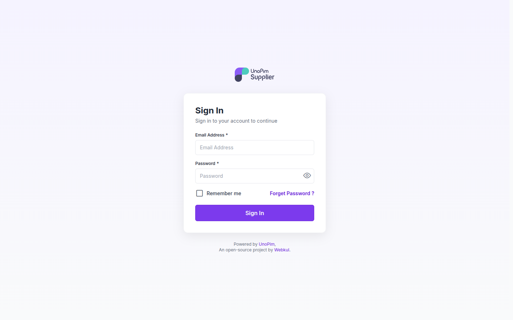

Forgot your password? Click **Forget Password?**, enter your email, and follow the link in the reset email.

---

## Step 2: Your dashboard

After you sign in, the dashboard shows an overview of your products:

| Card | What it shows |
|---|---|
| **Total Products** | All products you have created or imported |
| **Total Assigned Attribute Family** | How many product families you can create products in |
| **Approve Product** | Products approved and added to the catalog |
| **Pending Product** | Products waiting for review |
| **Rejected Product** | Products that need changes before they can be approved |

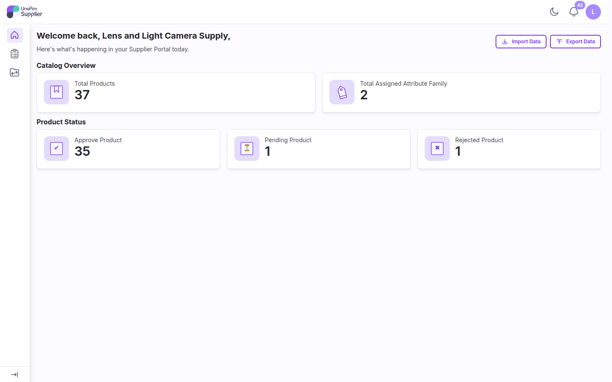

Use **Import Data** and **Export Data** at the top to go straight to imports and exports.

The bell icon shows your notifications. You get one each time a product is approved or rejected, and a rejection notification includes the reviewer's message.

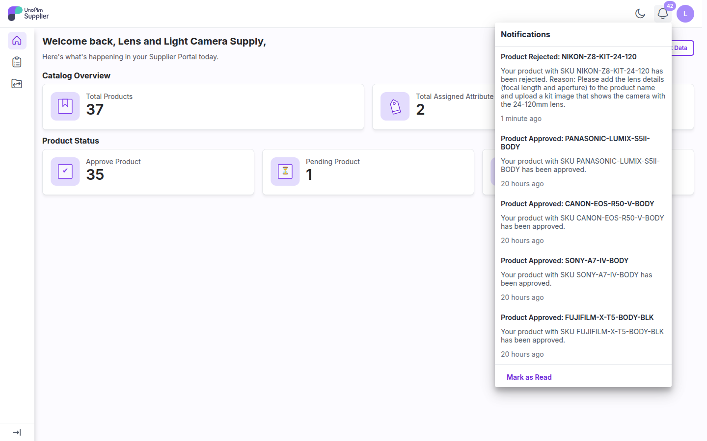

---

## Step 3: Your products

Open **Catalog → Products** from the sidebar to see all your products, with their **Approval Status**.

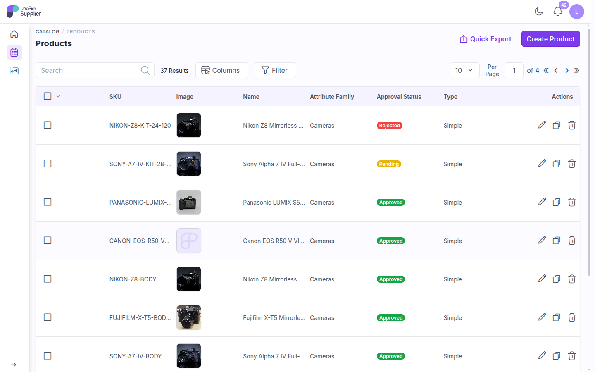

From this list you can:

- Search, filter, and choose which columns to show
- Edit (pencil), copy, or delete a product
- Select several products and delete them at once
- Download your products with **Quick Export**

---

## Step 4: Add products

### Create a product

Click **Create Product**, choose:

- **Type**: **Simple**, or **Configurable** for a product with variants
- **Family**: one of the attribute families assigned to you
- **SKU**: a unique product code

Click **Save Product**. The product's edit page opens, where you fill in its attributes, categories and images.

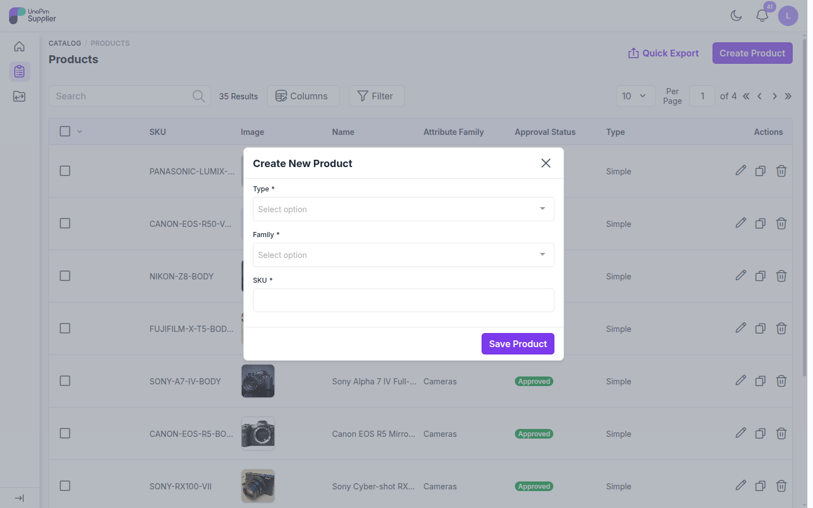

To create a similar product quickly, use the **copy** icon in the product list and change what is different.

### Import products

To add many products at once, open **Data Transfer → Imports** (or click **Import Data** on the dashboard) and click **Create Import**.

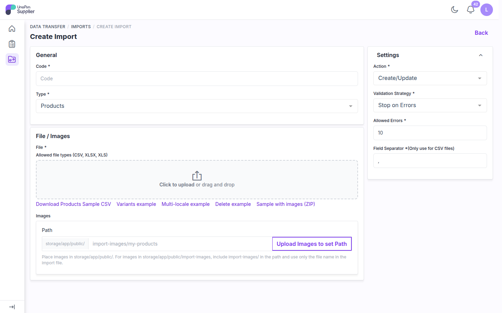

1. Enter a **Code** and keep **Type** set to **Products**.
2. Upload your file in **CSV**, **XLS** or **XLSX** format. Use **Download Products Sample CSV**, or one of the other samples (variants, multi-locale, delete, images ZIP), as a template.
3. To import images, click **Upload Images to set Path** and upload a ZIP of your images, or enter the path where they are stored.
4. Under **Settings**, choose the **Action** (**Create/Update** or **Delete**), the **Validation Strategy** and the number of **Allowed Errors**. For CSV files, set the **Field Separator**.
5. Save the import and run it.

Every imported product is set to **Pending** and sent for review automatically.

### Track import and export jobs

Open **Data Transfer → Job Tracker** to see the status of each import and export, its start and finish time, and to download error reports or exported files.

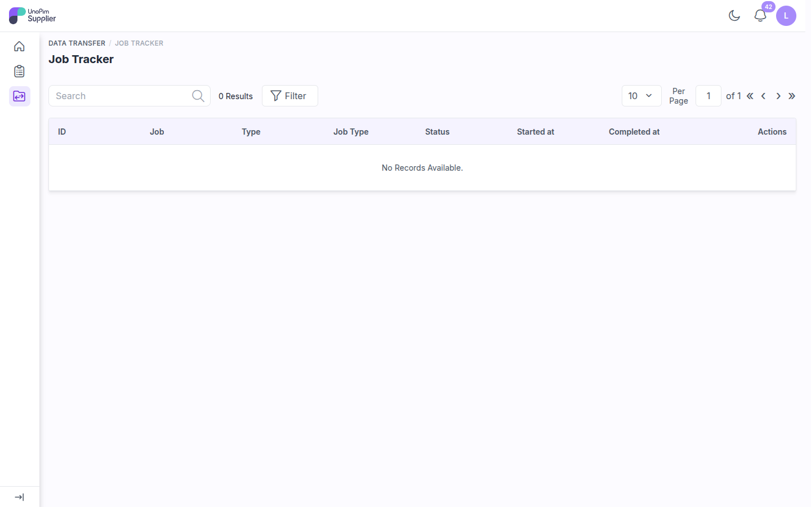

---

## Step 5: Export products

Open **Data Transfer → Exports** (or click **Export Data** on the dashboard) and click **Create Export**.

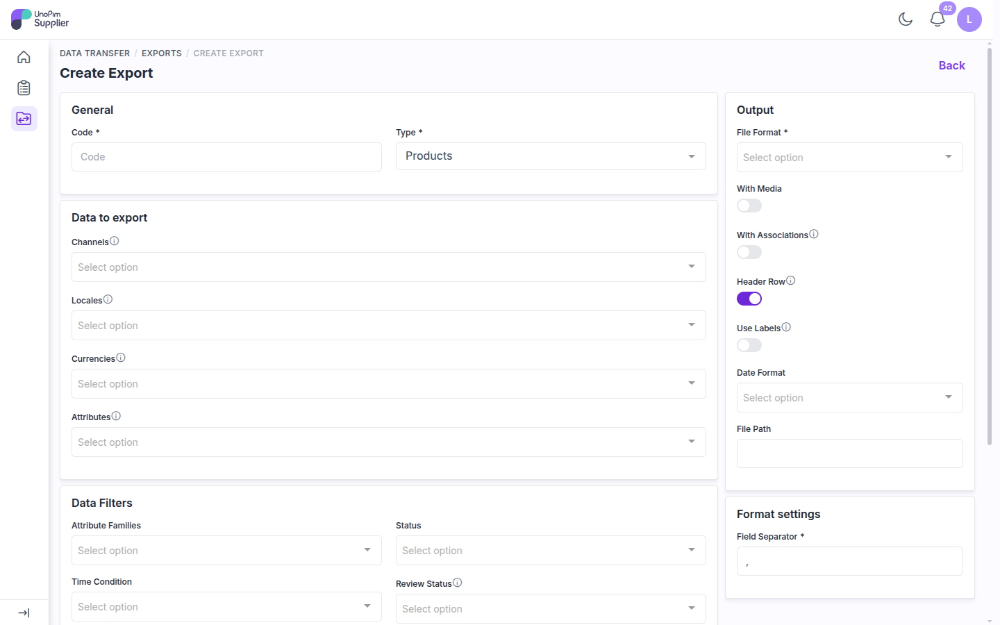

- **Output**: choose **CSV**, **XLS** or **XLSX**, and whether to include media, associations, a header row, and attribute labels instead of codes.
- **Data to export**: choose the channels, locales, currencies and attributes.
- **Data Filters**: limit the export by attribute family, **Status** (enabled or disabled), time condition, or **Review Status** (pending, approved or rejected).

Save the export and run it. Download the file from the export or from the **Job Tracker**.

---

## Step 6: Fix a rejected product

When a reviewer rejects a product, you get a notification and the product's status changes to **Rejected**.

1. Open the product from **Catalog → Products**.
2. Read the **Product Rejection Message**, shown in red on the right of the edit page. It tells you what to change.

   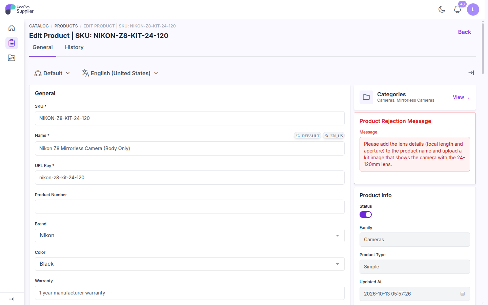

3. Make the changes. As soon as you change a field, a bar appears at the bottom of the page.
4. Click **Save changes**. The product goes back to **Pending** and is reviewed again.

   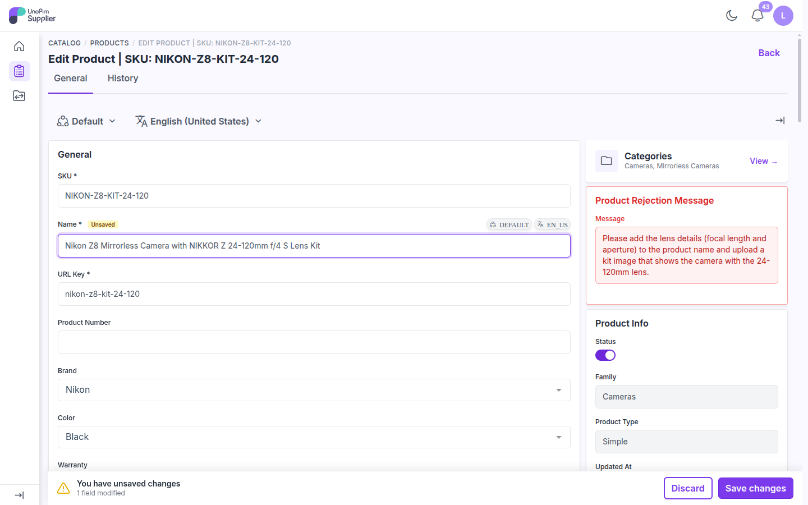

The rejection message is easy to read in dark mode too:

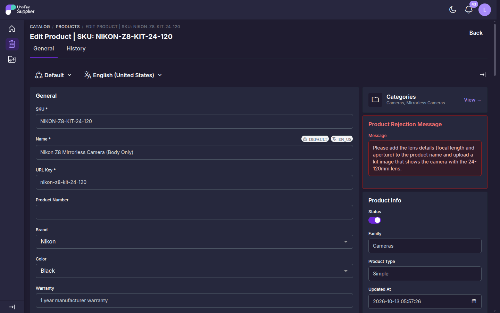

> **Tip:** Fix everything the message mentions before you save, so the product can be approved on the next review.

---

## What happens after approval?

An approved product is copied into the main UnoPim catalog, and your dashboard counts update. If you change an approved product later, it goes back to **Pending** until the reviewer approves the change.

---

## Your account

Click your avatar in the top right and open **My Account** to change your name, profile image, portal language (**UI Locale**), timezone or password. To change your password, enter your current password first.

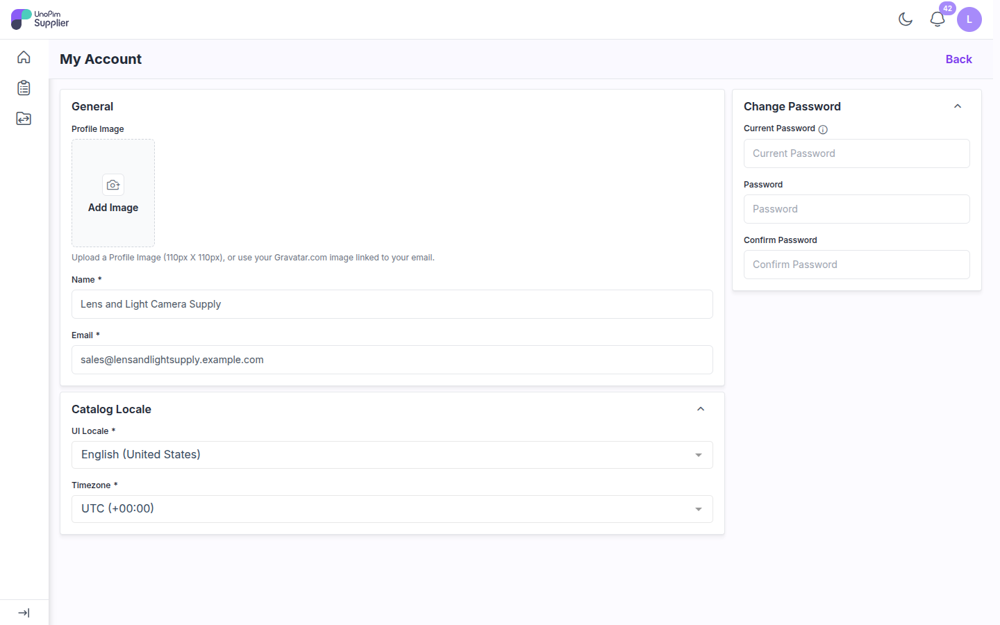
