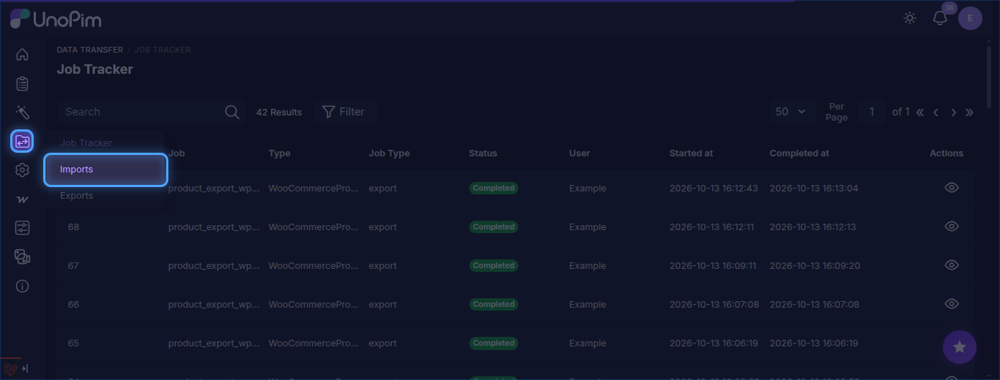
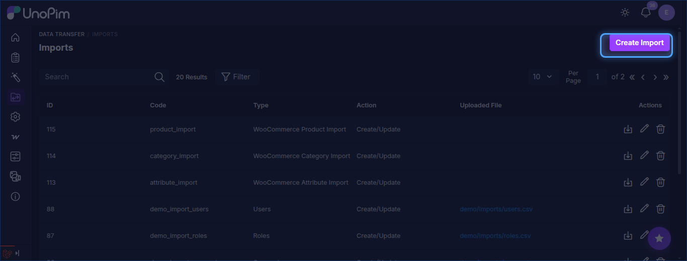
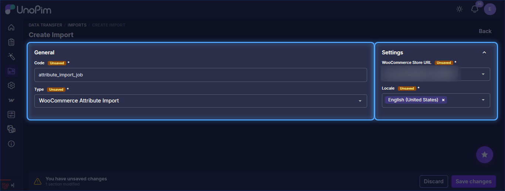
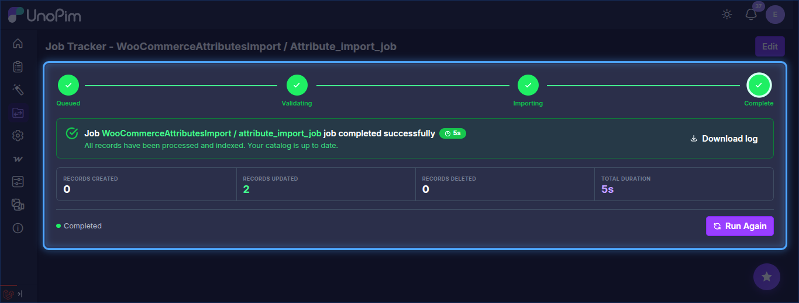

# Attribute Import

The UnoPim WooCommerce WPML addon allows users to import WooCommerce attributes into UnoPim in multiple languages simultaneously. Each selected locale is imported as a separate locale value on the UnoPim attribute record.

::: info
The Locale field is a multiselect — you can select multiple languages in a single job run. Each selected locale will be pulled as a separate WPML translation and stored under the corresponding locale in UnoPim.
:::

## Step 1 — Open the Import Section

To create an attribute import job, go to:

`Data Transfer > Imports`

From there, click **Create Import** in the top-right corner to open the import setup form.

## Step 2 — Create an Attribute Import Job

While creating the import job, the user needs to:

- Enter the **Code**.
- Search for and select **WooCommerce Attribute Import** as the import type.

## Step 3 — Configure Attribute Import Settings

Under **Settings**, configure the following fields:

| Field | Type | Required | Description |
|---|---|---|---|
| WooCommerce Store URL | Select | Yes | The WooCommerce credential that has **Enable WPML Export** turned on. The addon uses WPML's API to fetch each language's attribute translations from WooCommerce. |
| Locale | Multiselect | Yes | One or more UnoPim locales to import. For each selected locale, the addon fetches the matching WPML translation from WooCommerce and writes it to the corresponding locale on the UnoPim attribute. |

## Step 4 — Save and Run the Import Job

After entering the required values, click **Save changes** to save the import profile.

To run the job, open it from the Imports list and click **Run**. Once the job executes, the imported attributes will be available in UnoPim with each selected locale populated.

