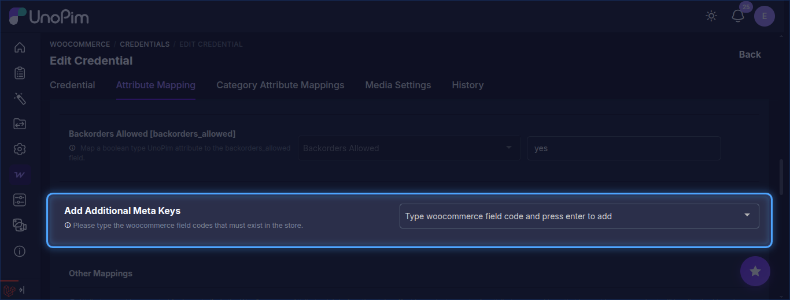
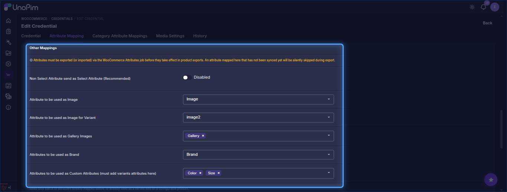
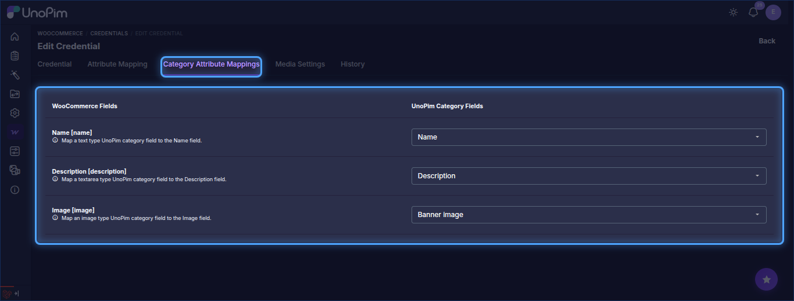
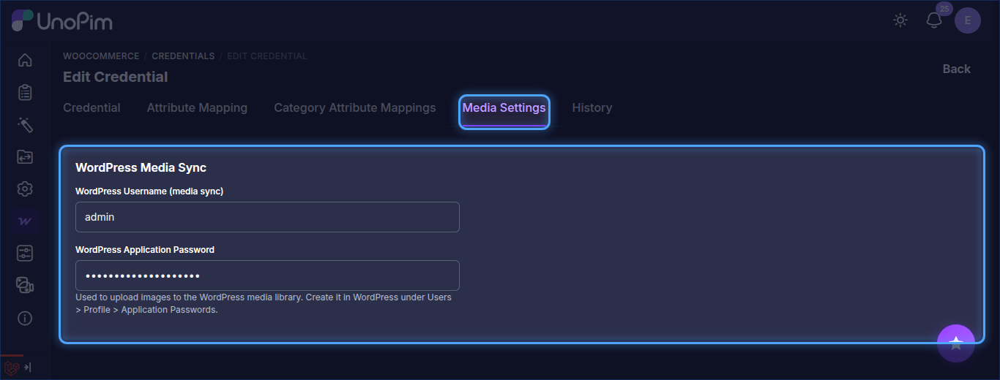

# Attribute Mapping

Attribute mapping connects UnoPim attributes to WooCommerce product fields. This tells the connector which UnoPim attribute to use for each WooCommerce field (name, price, description, etc.) during export and import.

Go to **WooCommerce → Credentials**, open a credential, and click the **Attribute Mapping** tab.

## Standard Field Mapping

Map each WooCommerce field to the matching UnoPim attribute:

| WooCommerce Field | Description |
|---|---|
| **SKU** `[sku]` | Unique product identifier |
| **Product Name** `[name]` | Title shown to customers |
| **Price** `[regular_price]` | Standard selling price |
| **Description** `[description]` | Full product description |
| **Short Description** `[short_description]` | Brief product summary |
| **Weight** `[weight]` | Used for shipping |
| **Length / Width / Height** | Dimensions for packaging |
| **Quantity** `[stock_quantity]` | Available stock (map to a text attribute) |
| **Slug** `[slug]` | URL-friendly product name |

## Additional Meta Keys

To map custom WooCommerce fields, enter the field code under **Additional Meta Keys** and press Enter, then assign a UnoPim attribute to it.

## Other Mappings

| Option | Description |
|---|---|
| **Non Select Attribute send as Select Attribute** | Enable when a WooCommerce field should be treated as a select-type value |
| **Attribute to be used as Image** | UnoPim attribute used as the main product image |
| **Attribute to be used as Image for Variant** | UnoPim attribute used as the variant image |
| **Attribute to be used as Gallery Images** | UnoPim attributes used as gallery images |
| **Attributes to be used as Brand** | UnoPim attribute used as the brand |
| **Attributes to be used as Custom Attributes** | Defines which UnoPim attributes are sent as WooCommerce custom attributes. Variant attributes must be added here. |

> **Note:** Attributes must be exported (or imported) via the WooCommerce Attributes job before they take effect in product exports. Unsynced attributes are skipped.

## Quick Export Settings

Configure default values used by quick export jobs:

| Field | Description |
|---|---|
| **Default Channel** | Channel used when quick-exporting products |
| **Default locale for WPML export** | Locale used for quick exports |
| **Default Currency** | Currency used for quick exports |
| **Include media in quick export** | Also export product media during quick export |
| **Auto Sync Products** | When enabled, product creates, updates, and deletes in UnoPim are automatically pushed to WooCommerce |

## WPML Export Settings

This section is added by the WooCommerce WPML add-on. It appears at the bottom of the Attribute Mapping tab.

| Setting | Description |
|---|---|
| **Enable WPML Export** | Toggle **on** to activate multi-locale WPML mode for this credential. When off, exports use standard single-locale WooCommerce behaviour. |
| **Default locale for WPML export** | The UnoPim locale treated as the original language. All other locales selected in an export job become WPML translations of it. Must match the default language configured in WPML on WordPress. |

::: warning
Enable WPML Export only after WPML is installed and configured in WordPress. Enabling it without WPML active will cause export jobs to fail.
:::

## Category Attribute Mappings

The **Category Attribute Mappings** tab maps WooCommerce category fields (**Name**, **Description**, **Image**) to UnoPim category fields.

## Media Settings

The **Media Settings** tab holds the WordPress username and application password used to upload images to the WordPress media library.

Click **Save** after completing all mapping sections.
