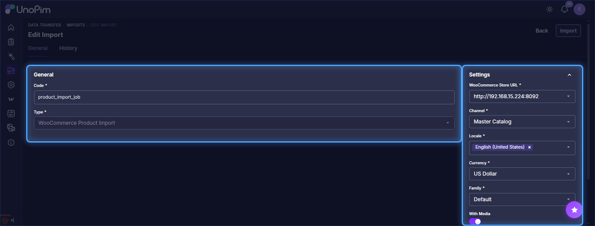
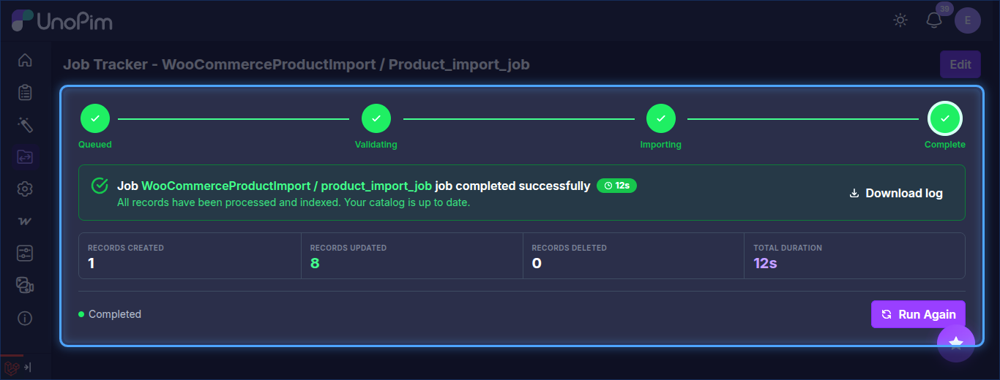

# Product Import

The UnoPim WooCommerce WPML addon allows users to import WooCommerce products into UnoPim in multiple languages simultaneously. Each selected locale is imported as a separate locale value on the UnoPim product record.

::: info
The Locale field is a multiselect — you can select multiple languages in a single job run. Each selected locale will be pulled as a separate WPML translation and stored under the corresponding locale in UnoPim.
:::

## Step 1 — Open the Import Section

To create a product import job, go to:

`Data Transfer > Imports`

From there, click **Create Import** in the top-right corner to open the import setup form.

## Step 2 — Create a Product Import Job

While creating the import job, the user needs to:

- Enter the **Code**.
- Search for and select **WooCommerce Product Import** as the import type.

## Step 3 — Configure Product Import Settings

Under **Settings**, configure the following fields:

| Field | Type | Required | Description |
|---|---|---|---|
| WooCommerce Store URL | Select | Yes | The WooCommerce credential that has **Enable WPML Export** turned on. The addon uses WPML's API to fetch each language's product translations from WooCommerce. |
| Channel | Select | Yes | The UnoPim channel to assign imported products to. |
| Locale | Multiselect | Yes | One or more UnoPim locales to import. For each selected locale, the addon fetches the matching WPML translation from WooCommerce and writes it to the corresponding locale on the UnoPim product. |
| Currency | Select | Yes | The currency to use when importing product pricing data. |
| Family | Select | Yes | The UnoPim product family to assign to all imported products. |
| With Media | Boolean | No | Enable this option if product images should also be imported from WooCommerce. |

## Step 4 — Save and Run the Import Job

After entering the required values, click **Save changes** to save the import profile.

To run the job, open it from the Imports list and click **Run**. Once the job executes, the imported products will be available in UnoPim with each selected locale populated across the specified channel.

