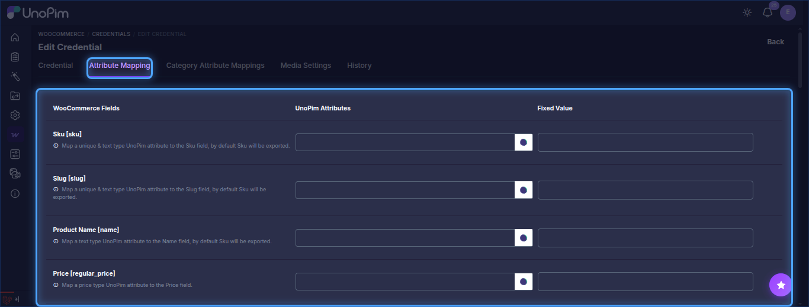
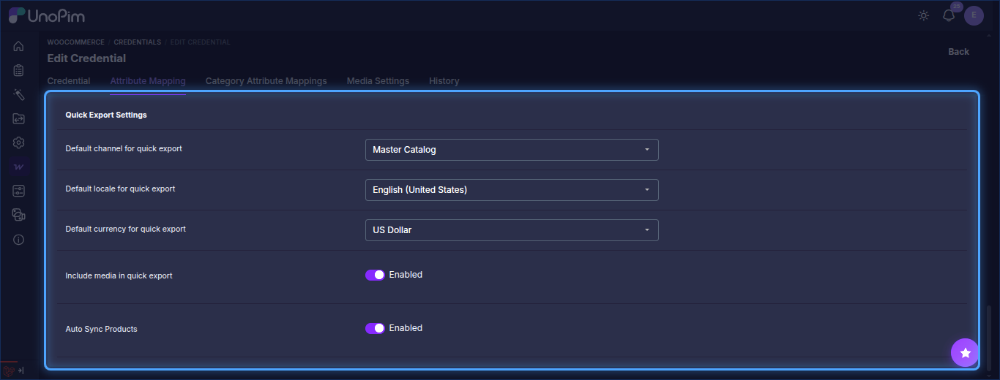

# Attribute Mapping in UnoPim

Attribute mapping allows users to connect WooCommerce product fields with the correct UnoPim attributes. This ensures that product data is transferred into the right fields during synchronization.

Open a credential from **WooCommerce > Credentials** and go to the **Attribute Mapping** tab.

While setting up the mapping, users need to select the UnoPim attribute that matches each WooCommerce product information field.

## Default WooCommerce Fields Available for Mapping

By default, the following WooCommerce fields can be mapped with UnoPim attributes:

- **SKU `[sku]`**: Unique identifier for each product, used for inventory and tracking.
- **Slug `[slug]`**: URL-friendly version of the product name used in permalinks.
- **Product Name `[name]`**: The title of the product displayed to customers.
- **Price `[regular_price]`**: Standard selling price of the product.
- **Description `[description]`**: Full product description shown on the product page.
- **Short Description `[short_description]`**: Brief product summary typically shown near the top of the product page.
- **Weight `[weight]`**: Physical weight of the product, commonly used for shipping calculations.
- **Length `[length]`**: Product length dimension used for shipping or display.
- **Width `[width]`**: Product width dimension used for packaging or logistics.
- **Height `[height]`**: Product height dimension used in physical handling.
- **Quantity `[stock_quantity]`**: Available stock quantity for the product.
- **Is Featured? `[featured]`**: Indicates whether the product is marked as featured in the store.
- **Purchase Notes `[purchase_note]`**: Message sent to customers after purchase, usually for instructions or follow-up information.
- **Reviews Allowed `[reviews_allowed]`**: Defines whether customers can leave reviews for the product.
- **Backorders Allowed `[backorders_allowed]`**: Defines whether the product can be ordered when it is out of stock.

> **Note:** For the WooCommerce **Quantity `[stock_quantity]`** field, map a UnoPim **text-type attribute**.

## Add Additional Meta Keys

The connector also allows users to add custom WooCommerce fields through **Additional Meta Keys**.

In this section, users can enter a WooCommerce field code and press **Enter** to add it as a new mapping field. After that, they can assign the appropriate UnoPim attribute to the newly added field.

## Other Mappings

Under **Other Mappings**, the admin can configure the following options:

- **Non Select Attribute send as Select Attribute (Recommended)**: Use this option when a WooCommerce field should be handled as a select-type value during synchronization.
- **Attribute to be used as Image**: Select the UnoPim attribute that should be used as the main product image.
- **Attribute to be used as Image for Variant**: Select the UnoPim attribute that should be used as the variant image.
- **Attribute to be used as Gallery Images**: Select the UnoPim attributes that should be used as gallery images.
- **Attributes to be used as Brand**: Select the UnoPim attribute that should be used as the brand.
- **Attributes to be used as Custom Attributes**: Define which UnoPim attributes should be treated as custom attributes in WooCommerce. Variant attributes must also be added here.

> **Note:** Attributes must be exported (or imported) via the WooCommerce Attributes job before they take effect in product exports. An attribute mapped here that has not been synced yet will be silently skipped during export.

## Quick Export Settings

Under **Quick Export Settings**, the admin needs to configure the following default values:

- Select the default **channel** for quick export.
- Select the default **locale**.
- Select the default **currency**.
- Enable **Include media in quick export** if product media should also be exported during quick export.
- Enable **Auto Sync Products** if products should be synced automatically from UnoPim to WooCommerce when they are created, updated, or deleted.

For **Quick Export**, enabling auto sync is not required. The admin only needs to assign the default values for **channel**, **locale**, and **currency** in the attribute mapping, and then enable **Quick Export** in the credential settings.

After completing the mapping configuration, click **Save** to store the settings.

## Category Attribute Mappings

The **Category Attribute Mappings** tab maps WooCommerce category fields to UnoPim category fields:

- **Name `[name]`**: Map a text-type UnoPim category field.
- **Description `[description]`**: Map a textarea-type UnoPim category field.
- **Image `[image]`**: Map an image-type UnoPim category field.

## Media Settings

The **Media Settings** tab holds the **WordPress Media Sync** credentials (WordPress username and application password) used to upload images to the WordPress media library, which also helps avoid duplicate images being created on repeated exports. See [Setup Credentials](./setup-credentials) for details.

