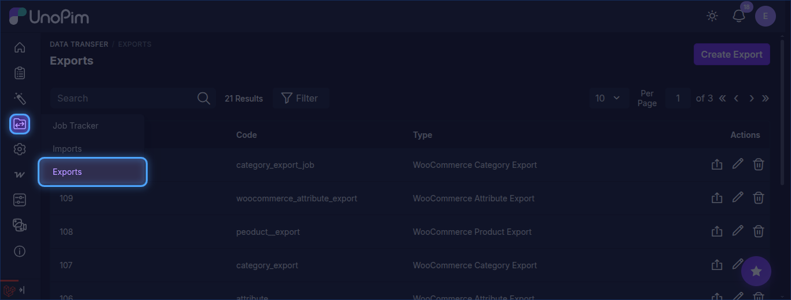
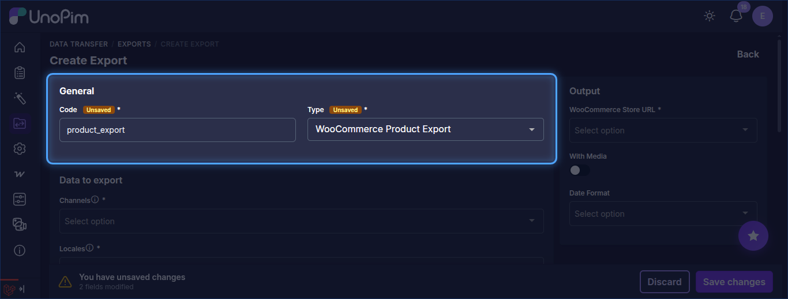
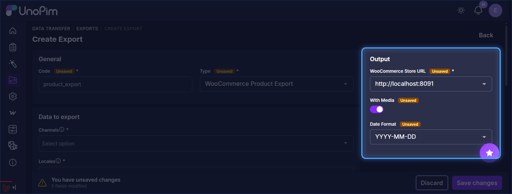
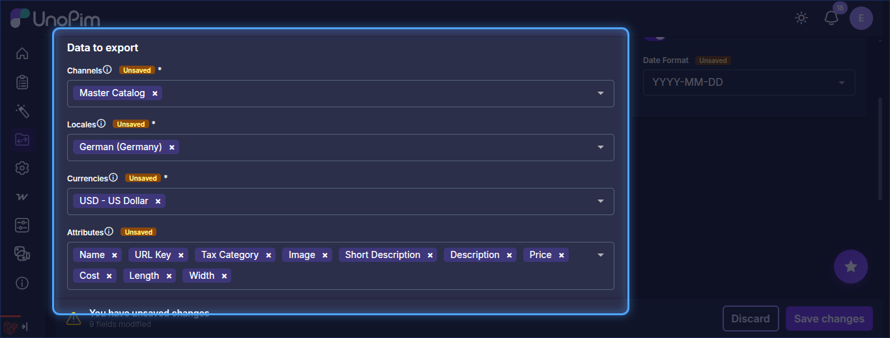
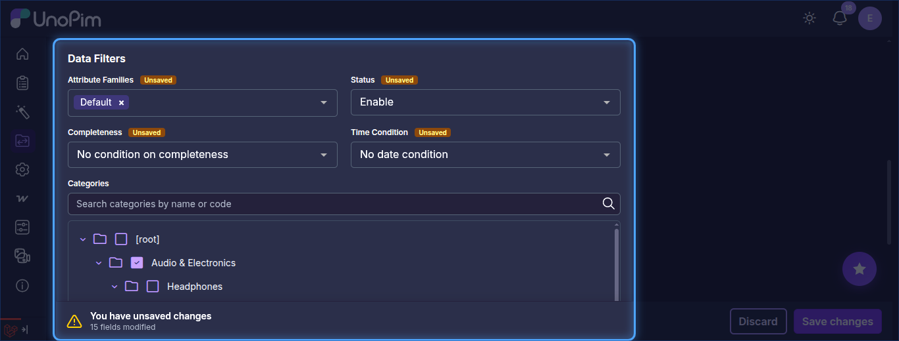
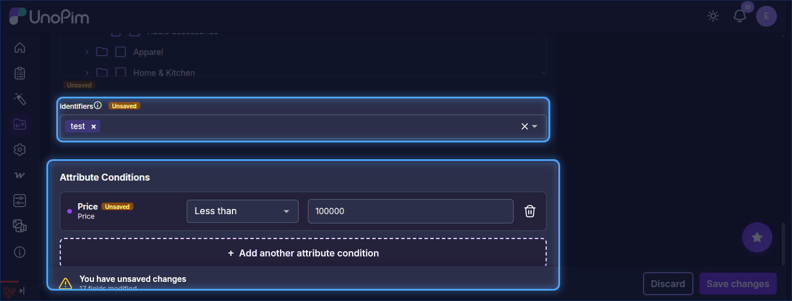
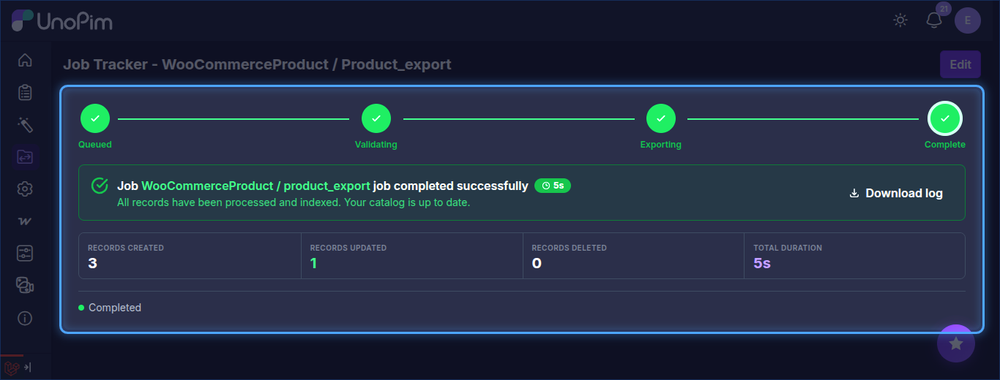

# Product Export

The UnoPim WooCommerce Connector allows users to export product data from UnoPim to WooCommerce through dedicated export jobs.

## Open the Export Jobs Section

To create a product export job, go to:

`Data Transfer > Exports`

From the Exports page, click **Create Export** in the top-right corner.

## Create a Product Export Job

While creating the export job, the user needs to:

- Enter the **Export Job Code**.
- Select **WooCommerce Product Export** as the export job type.

## Product Export Filters

After selecting the product export job type, configure the following options under **Output**:

- **WooCommerce Store URL**: Select the required WooCommerce store credentials.
- **With Media**: Enable this option if product images should also be exported to WooCommerce.
- **Date Format**: Select the date format to use for exported date values.

Under **Data to export**, select:

- **Channels**: Select the channel for exporting.
- **Locales**: Select the required locale.
- **Currencies**: Select the required currency.
- **Attributes**: Select the attributes to export (optional).

Under **Data Filters**, you can narrow down which products are exported:

- **Attribute Families**: Export only products from the selected families.
- **Status**: Filter products by enabled or disabled status.
- **Completeness**: Filter products by completeness.
- **Time Condition**: Filter products by date condition.
- **Categories**: Select categories from the category tree.

- **Identifiers**: Enter the SKUs of specific products that need to be exported.
- **Attribute Conditions**: Add conditions on attribute values (for example, **Price** less than `100000`) using **Add another attribute condition**.

## Save and Run the Export Job

After filling in the required details, click **Save changes** to create and save the export job.

Once the export job is run, the user can monitor its progress from the **Job Tracker**.

After the export completes successfully, the products will be visible in the connected WooCommerce store.
